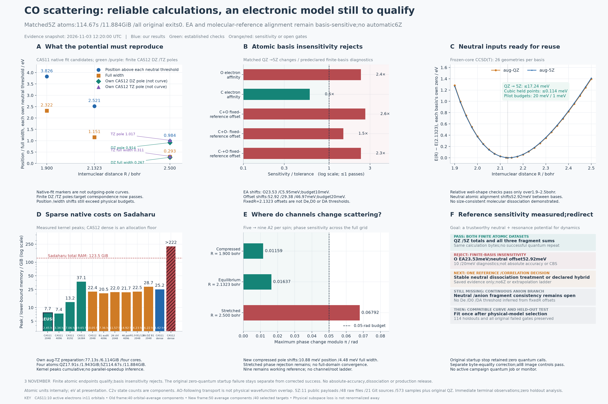

# CO fixed-nuclei scattering and reference calculations

**Status: reproducible finite-model calculations; no production CO potential.**
The source-built UKRmol+ engine, common state-averaged target/import pipeline,
selected-spectrum scattering and independent outer-region checks work in their
tested domains. Electronic-model convergence, molecular dissociation and a
continuous resonance-to-bound-anion branch remain unqualified.

## Start here

- [Established results and rejected routes](../../docs/physics/co-results-and-rejected-routes.md):
  compact scientific conclusions, including which blind alleys must not be reopened
  merely because their implementation passed.
- [Running and reproducing](RUNNING.md): Docker, target controls, batch interface,
  saved-data replay and resource conventions.
- [Evidence index](qualification-evidence/README.md): public, hash-verified raw
  records, independent readers and original failures.
- [Production decisions](PRODUCTION_DECISIONS.md), [readiness gates](SWEEP_READINESS.md)
  and [current handoff](CONTINUATION.md): current authority, not a dated launch log.
- [Research queue](RESEARCH_PLAN.md): remaining physical questions and finite bounds.

## Settled contributions

| Capability | Implementation / permanent explanation |
|---|---|
| Multi-spin/multi-irrep state-averaged target | `target.py`, `state_average.pm`; [method](../../docs/physics/co-state-averaged-target.md) |
| Fixed-orbital CI coverage, spin and checkpoint checks | `ci_probe.py`, `ci_overlap.py`; [qualification](../../docs/physics/co-electronic-qualification.md) |
| Native selected-spectrum scattering and dense differentials | `sparse_scattering.py`; [replay guide](SPARSE_SCATTERING.md) |
| Native surface/energy conventions and exterior propagation | `native_boundary.py`, `exterior_numerov.py`; [normalization](../../docs/physics/co-native-boundary-conventions.md) |
| Physical shell/coupled-tail and outgoing-pole controls | `physical_pole.py`, `coupled_tail.py`, `coupled_jost.py`; [physical benchmark](../../docs/physics/co-physical-pole-benchmark.md) |
| Optional precision-preserving residual kernel | [native extension](../../native/qscat-extended/README.md), NumPy differential oracle |
| Neutral well and atomic references | `neutral.py`, `atomic_references.py`; [atomic protocol](../../docs/physics/co-atomic-energy-references.md) |
| Independent saved-only reconstruction | `verify_*.py`, per-study readers and public artifact manifests |

Experimental modules stay in `projects/`: none of this promotes an electronically
unqualified CO model to `qscat`. Frozen execution contracts describe historical
allocations; their authorization fields do not release a new calculation today.

## Current scientific outcome

- The 52 QZ/5Z neutral points pass relative-basis/interpolation checks only over
  **1.9–2.5 bohr**. All four restricted RHF attempts at 3/4 bohr failed external
  stability before CCSD(T); there is no accepted dissociation continuation.
- Finite stretched DZ/TZ poles independently qualify, but differ by
  **103.37 meV in position and 44.17 meV in full width**. Both physical budgets
  reject. Retained-target correspondence does not prove unique N+1 state identity.
- Four matched aug-QZ/5Z atomic endpoints reconstruct. The **23.53-meV O EA**
  basis shift exceeds 10 meV; atomic-to-fixed-molecular-reference offset shifts
  **52.92/29.38/46.97 meV** all exceed 20 meV. These offsets are not De, D0 or
  initial-v attachment thresholds. No automatic 6Z/CBS ladder follows.
- Aug-TZ properties and preparation qualify; the unchanged six-open-channel
  export is blocked by thresholds crossing its requested grid. Inner/pole work
  is parked, not evidence of a failed diffuse electronic model.

Next is one bounded neutral/correlation/reference-treatment decision, not more
scattering-interface work. All 114 S-matrix holdouts and the specified equilibrium
outgoing-pole exclusion remain protected. Nine is the working channel reference;
new50 is parked and the qualified 2048-root baseline is retained.

## Progress overview

[Vector figure](../../docs/physics/figures/co-progress-20261103T1220-atomic-basis.svg) ·
[Plotted evidence](progress-snapshot-review-20261103.json).

Only the latest overview is kept in the working tree. Superseded figures,
chronological handoffs and their exact rendering inputs are preserved in the
[public campaign-history archive](qualification-evidence/campaign-history/README.md).
Small historical JSON snapshots remain as regression fixtures; their old
"next" entries are not current authority.

## Reproducibility boundary

Inputs, raw failures, public artifact pointers and source-authenticating commits
are retained. Do not squash away execution commits without replacing the readers'
Git-source authentication contract. Public archives contain original producer
sources; numerical replay and saved-only reconstruction have different meanings.
Extract downloaded archives outside the checkout to avoid mixing historical and
current source trees. Untracked discussion reports and scratch notes are not
required to understand or reproduce the settled contributions.
