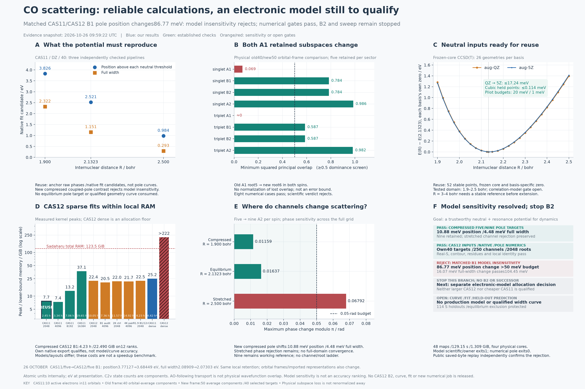

# UKRmol+ CO fixed-nuclei scattering experiment

**Status:** the source-built engine and common state-averaged target/import
pipeline work. Equilibrium angular-cutoff and stretched energy-grid checks
meet the chosen tolerances for the tested CAS(10,10) model. Electronic-model
and resonance-extraction qualification remain open, so production
potential-fitting targets are not yet qualified.

**Campaign discipline:** the [goal-convergence checklist](PRODUCTION_DECISIONS.md#goal-convergence-checkpoint--every-one-or-two-days-of-campaign-work)
is reviewed every one or two days of active work. Each cycle must name the
sweep/potential decision it changes and end with continue/redirect/stop—not just
another collection of passing checks. See the dated checkpoint for the current
bounded deliverable and unresolved scientific blockers.

**26 October outcome:** [matched CAS11/CAS12 B1 pole insensitivity rejects](qualification-evidence/compressed-cas12-pole/README.md).
Position shifts **86.77meV**, beyond50meV; full width shifts16.07meV and passes.
Real-S/pole/residue/character/local-identity gates independently reconstruct:
this is model sensitivity, not a failed solver.48 maps /129.15s /1.309GiB,
original model exits1, numerical pole exits0. **Stop this contrast branch; no B2
or automatic successor.** Redirect to a separately reviewed electronic-model
allocation decision; neither model is qualified for a production sweep or fit.
Optimized frames/imported target representations change too, so this is not an
isolated active-orbital-count effect or proof CAS12 is more accurate.

The [prior five/nine pole contrast passes](qualification-evidence/compressed-a2-contrast/README.md)
both sectors; retain nine as working reference. Reused
[matched CAS12 properties](qualification-evidence/compressed-cas12-properties/README.md),
[preparation](qualification-evidence/compressed-cas12-preparation/README.md) and
[B1/2048 native export](qualification-evidence/compressed-cas12-inner/README.md)
independently qualify; none was repeated for the pole test. New50 stays parked,
2048 retained, all114 holdouts/equilibrium exclusion protected. No qualified CO
curve, electronic model or full-scattering embedding exists.

**23 October,10:12UTC result:** [the bare direct-S fitting shortcut rejects](DIRECT_SCATTERING_SCREEN.md)
at all three anchors/both sectors,392/480 development matrices, in0.872s with
no native call or potential fit. This rules out an incompatible bare full-matrix
fitter, not effective scalar/tail-dressed potentials. Next define the justified
channel-to-effective-model target map; width identification remains unresolved.

**10:56UTC design outcome:** the
[scalar target map](../../docs/physics/co-effective-resonance-target.md) preserves
a coupled outgoing pole's energy/full width, not channel branching or background.
It requires prediction at an excluded geometry, not replay of fitted pole factors.
No qualified CO pole or potential is produced; full-scattering validation remains
open. The design cycle is complete. Decide on bounded one-anchor pole-reference
feasibility versus a coupled-model redirect before launching further numerical work.

**13:21UTC result:** [finite298-channel outgoing-map feasibility passes](OUTGOING_MAP_CANARY.md)
at compressed/nine/B1. Three development S matrices reproduce within1.51042e-7;
one complex map is stable across five settings. Cost55.85s, no engine/pole search
or holdout analysis. Original dependency stop2/2/2 is preserved beside the
unchanged-numerics successor0/0/0. Public saved reconstruction verifies all40
row gates. Next is a bounded one-anchor pole-reference proposal, not a general
solver campaign; no qualified CO pole/width or potential has been produced.

**14:55UTC result:** [one compressed finite-reference outgoing pole](COMPRESSED_POLE_REFERENCE.md)
is numerically witnessed: **3.7604physical eV position /2.0846physical eV full
width**, CAS11/nine-A2/B1,2048 roots/all298 channels. Boundary matching, interior
contour and visible open-channel residue pass, with public saved reconstruction.
Cost180.99s; no new engine/inner solve, geometry, potential fit or holdout S
analysis. This does not establish electronic accuracy, an independent exterior
or a CO width curve. Next is a bounded paired-sector/angular-character proposal,
not automatic expansion to more geometries or a solver campaign.

**17:36UTC result:** [the compressed finite-reference B1/B2 open-Pi pair passes](PAIRED_POLE_CHARACTER.md),
not degeneracy alone: both residues have about1.15e-9 leakage outside `|m|=1`.
B1 is reused; B2 uses42 maps /173.06s, all pole/character gates independently
reconstruct. All three B2 settings accept the B1 seed directly, not zero splitting
uncertainty or independent root iterates. Electronic accuracy and a CO curve
remain open. Redirect next to a matched electronic-model pole-contrast proposal
from saved sparse inputs; no new geometry, model solve, fit or sweep is released.

**25 October design/availability outcome:** the
[matched pole-contrast proposal](../../docs/physics/co-compressed-a2-pole-contrast.md)
identifies a reusable250-versus298-channel control at1.9bohr, not a new inner
calculation. Public metadata checks confirm the original-ID map; the native
zero-Buttle K path bypasses the problematic dense-pointer branches here.
The later saved-view gate passes both sectors in2.073691s /.223804GiB, preserving
strict failure and all original bytes; independent public reconstruction confirms
the arrays. At that saved-only gate, at most146 future maps were proposed,
conditional on a separate execution freeze; **zero maps were evaluated there**.
That saved-view result alone is not model-insensitivity or electronic accuracy.

**23:24UTC independently verified outcome:** the numerical five/nine contrast now
passes both sectors, including real-S, root/contour/residue/Pi/identity and
counterpart gates. Five-model pole3.771266eV /2.089095eV full width; nine-model
3.760390eV /2.084614eV reused without propagation.89/146 maps /216.873s /
1.738GiB, exits0/0/0/0. This is compressed finite-reference pole-target
insensitivity, not full-domain channel convergence or electronic accuracy.
The next model allocation uses saved CAS12 eigenvectors and firstfive-per-sector
properties; no equilibrium pole, new geometry, fit or sweep is consumed.

The completed evidence preserves the first pilot and two calibration snapshots:

| Campaign | Attempts | Validated pipelines | Preserved failures | Comparisons | Public evidence |
|---|---:|---:|---:|---:|---|
| Original SEP/ground-state-CASSCF calibration | 40 | 30 | 10 | 21 | [`evidence/`](evidence/README.md) |
| Multi-spin/multi-irrep state-averaged continuation | 55 | 29 (17 target-only, 12 scattering) | 26 | 12 | [`sa-evidence/`](sa-evidence/README.md) |

The continuation also includes 96 native RESON replays and six fixed-orbital
CI coverage probes. “Validated” means solver/import and pipeline consistency,
not electronic-model convergence. The CAS(10,11) fresh-CI restart passes all
40 averaged-root imports and the ground-dipole check, but active-space changes
remain substantial. The CAS(10,12) memory retry passed QC/fresh-CI checks and
singlet-A1 diagonalization, then exceeded its triplet-A1 memory budget.
[`CONTINUATION.md`](CONTINUATION.md) records their host state and next gates.

The [current root-resolution decision](ROOT_RESOLUTION_DECISION_20261014.md),
[completed matched A2 scattering control](A2_CHANNEL_SCATTERING.md),
[completed nine-A2 attribution check](A2_ROOT_ATTRIBUTION.md),
[saved model/extraction controls](SAVED_MODEL_CONTROLS.md),
[completed equilibrium A2 control](A2_EQUILIBRIUM_CONTROL.md),
[completed compressed A2 control](A2_COMPRESSED_CONTROL.md),
[same-engine active-space reconstruction](qualification-evidence/same-engine-active-space/README.md),
[prospective phase-extraction study](PHASE_EXTRACTION.md),
[analytic width-identifiability audit](PHASE_IDENTIFIABILITY.md),
[saved K/S matrices and interface audit](SAVED_MATRICES.md),
[physical outgoing-pole benchmark](PHYSICAL_POLE_BENCHMARK.md),
[matrix tail/threshold controls](COUPLED_TAIL_BENCHMARK.md),
[combined exterior refinement rejection](COMBINED_EXTERIOR_BENCHMARK.md),
[bounded exterior resolution control](COMBINED_EXTERIOR_RESOLUTION.md),
[independent native exterior pilot](NATIVE_EXTERIOR_PILOT.md),
[native-subrange attribution control](NATIVE_EXTERIOR_ATTRIBUTION.md),
[six-case saved-native reconstruction](NATIVE_FULL_RECONSTRUCTION.md),
[stretched 1-eV error attribution](NATIVE_K_ATTRIBUTION.md),
[fixed-grid Numerov algebra control](NUMEROV_INCREMENT_CONTROL.md),
[cross-anchor / all-finest-endpoint qualification](NUMEROV_CORNER_CONTROL.md),
[interior stress prerequisite rejection](NUMEROV_INTERIOR_CONTROL.md),
[fixed-grid matrix precision attribution](NUMEROV_PRECISION_ATTRIBUTION.md),
[extended-arithmetic qualification](NUMEROV_ARITHMETIC_CONTROL.md),
[coupled precision and dense-cost control](NUMEROV_COUPLED_PRECISION.md),
[dense setup-versus-interval scaling](NUMEROV_DENSE_SCALING.md),
[recurring mixed-solve profile and operands](NUMEROV_SOLVE_PROFILE.md),
[native extended residual primitive](NUMEROV_NATIVE_RESIDUAL.md),
[native residual coupled integration](NUMEROV_NATIVE_INTEGRATION.md),
[completed A2 target/property gate](A2_CHANNEL_TARGET_PREFLIGHT.md),
[completed-pair status update](SWEEP_READINESS_20261014T0658.md) and
[detailed roadmap](SWEEP_READINESS.md) state the ordered experiments,
current blockers and pass criteria: target inputs → affordable CAS12 scattering
→ electronic/channel convergence → continuity/extraction → neutral reference
→ frozen restartable pilot → sweep and held-out potential validation.

**Update — 14 October, 10:34 UTC:** the user accepts the completed CAS12
2048→4096 comparison as [sufficient root-resolution evidence for now](ROOT_RESOLUTION_DECISION_20261014.md).
The 8192 experiment is administratively cancelled after 2.50016 hours of partial
B1 assembly; original exits and partial evidence are
[preserved](progress-audited-8192-cancelled-20261014T1034.json). Both services are
inactive. Use the economical 2048 baseline for matched model/channel/extraction
controls; further root expansion needs a specific decision-changing discrepancy.
CAS12's 1.67e-5-rad phase difference is a refinement difference, not an absolute
4096-root error. The sweep remains gated by model, identity, extraction and neutral
qualification.

**Status — 15 October, 21:28 UTC:** the
[saved model/extraction study](SAVED_MODEL_CONTROLS.md) rejects equilibrium
CAS11→CAS12insensitivity at **0.1213rad / 64–73meV** in fitted position.
CAS12root refinement preserves the rejection. Stretched nine-A2width extraction
still spans **6.99%**,above5%,despite passing held-phase predictions. All96
declared cases remain in the gate;original false/unset outcomes are preserved.
[Public reconstruction](qualification-evidence/saved-model-controls/README.md)
passes124raw files and57frozen sources on downloaded payloads.

**Update — 21 October,21:55UTC:** [saved scattering phases and property IDs](SCATTERING_INPUT_MAP.md)
pass:317,988 first-term phases reproduce exactly; **25/40 idtarg positions change**.
Saved CONGEN definitions and existing properties are reusable candidates without
regeneration/export. Actual scattering-destination native reads and downstream
consumer semantics remain gated; both physical A1 rejections remain. No native
program or Hamiltonian ran. Completion6.833s /.703GiB process RSS; original parser
failure preserved. Compact public replay does not reauthenticate full raw N+1 CSFs.

**Earlier update — 21 October,19:55UTC:** [native target reuse and saved target integrals](NATIVE_TARGET_INTERFACE.md)
pass: all74 native vectors/energies byte-exact, h/overlap blocks exact, conservative
common-basis Hamiltonian difference bound **6.26708e-13Hartree**. Three original
build/ABI failures remain beside a matching-double-header completion0/0/0; no
successful target read is repeated. Four-job cost **3.761s /peak.12254GiB**.
No QC, target diagonalization or properties needed. Next fix the actual scattering
channel/property map and scientific contrast; physical A1 rejection remains.

**Earlier update — 21 October,18:20UTC:** the [exact signed target-CSF correspondence](NATIVE_CSF_MAP.md)
passes all8 sectors /158,994 CSFs and all74 saved target vectors. Only16 singlet-A1
CSFs flip sign; independent full canonical expansions and fresh public replay
agree exactly. The native phase-aware reader supports retaining original CIDATA
unchanged—no padding, QC, target diagonalization or property repeat. Producer
**16.496s /.60803GiB**, independent38.100s. Next qualify native consumer,
integral and scattering-channel interfaces; the physical A1 rejection remains.

**Earlier update — 21 October,17:40UTC:** [immutable-frame continuum preparation](IMMUTABLE_CONTINUUM.md)
generates154 MOs /141 continuum and all8 target-CSF files without QC, target
diagonalization, properties or scattering Hamiltonian. All8 CSFs match recorded
baseline full-layout hashes. The original trailer-check wrapper failure1/1/1 is
preserved; a separately frozen seven-sector completion passes0/0/0, reusing its
integrals/first CSF. Total **15.049s /peak2.46218GiB**; all6 public payloads verify.
Next prove signed native-target vector/address reuse before choosing compatible
scattering inputs. The physical two-A1 rejection remains; no scientific job runs.

**Earlier update — 21 October,16:49UTC:** the [physical ensemble-frame comparison](ENSEMBLE_FRAME_COMPARISON.md)
rejects the retained-five dominance screen in **both A1 sectors**: minimum squared
principal overlaps0.06930 and approximately zero versus0.5. All eight numerical
comparisons complete; scientific command/container/owner **1/1/1** are preserved.
Old retained A1 root5 maps strongly to new root6 in both spins. Cost **63.503s /
.49293GiB**, no QC or native/scattering call. Fresh public saved-wave replay
reconstructs all eight blocks within2.55351e-14. The new frame/properties stay
qualified, but lowest-five on both frames is not a clean same-manifold ensemble
contrast. Next declare the physical comparison and design immutable continuum
preparation/cost; no automatic root ladder, new Hamiltonian or sweep. No job runs.

**Earlier update — 21 October,15:38UTC:** the [explicit40-state property export](FIFTY_SELECTED_PROPERTIES.md)
passes native command/container/owner0/0/0 in **37.203min /.43713GiB**. Independent
reading reconstructs all40 target IDs /676 moments, energies, symmetry labels,
dipole and maps. All8 new public payloads /22 generated/owner files fresh-verify;
9 prerequisites reauthenticate. All620 moment values shared with the earlier
same-frame export are exact. The new50-component frame and selected properties
are now qualified; original seed rejection is preserved. No scientific job runs.
Next establish physical cross-frame channel correspondence and cost compatible
scattering preparation without repeating QC; no new inner solve is released.

**Earlier update — 21 October,14:54UTC:** the [completed new fifty-component frame](FIFTY_FRAME_COVERAGE.md)
independently passes **48 CI probes /74 native roots, vectors and EOF**, exits0/0/0,
in **5.144min /.27065GiB**. All5 public payloads /108 original files verify; the
original seed rejection remains separate. The saved global-low50 properties
contain only3 singlet-A2 states, so a new [explicit40-state property export](FIFTY_SELECTED_PROPERTIES.md)
is running from14:52UTC, expected30min /cap60min, no new QC or target solve.
It supplies the selected manifold needed before physical channel matching and
costing a matched orbital-ensemble scattering comparison. No new inner solve
or production sweep is released.

**Earlier result — 21 October,13:47UTC:** the [fifty-component target calculation](FIFTY_COMPONENT_IMPORT.md)
finishes, target/analyzer0/0, but independent seed-frame preservation rejects:
six averaged roots change by more than1e-7 Hartree (maximum3.38450e-7). Native
energies match the newly optimized frame within5.29468e-10 Hartree. Original
verifier1/1/owner1 and unset overall import remain preserved; the74-root binary
gate is not reached. Measured cost2.899h /5.518GiB, chiefly QC and DENPROP. All4
public payloads /153 original files fresh-verify. No scientific job runs. Next
cost separately qualified coverage of the completed new frame, **not another
reoptimization or a relaxed seed gate**, before matched ensemble scattering.

**Earlier launch — 21 October,10:52UTC:** an equilibrium **fifty-component CAS11 native
target calculation is running** on eight physical cores, advancing the orbital-
ensemble model decision. The original forty→fifty QC ground-energy change is
+0.456512eV; its scattering effect is not yet measured. The run imports74 covered
target roots, with all-root/dipole/frame checks and original outcomes retained.
Forecast1h expected /2h upper /3h hard cap /24GiB memory. See the
[costed production decisions](PRODUCTION_DECISIONS.md), [finite contract](fifty-import-contract-20261021.json)
and [launch capture](progress-fifty-import-launch-20261021.json). A passing import
enables costing a matched-channel scattering contrast; production widths and the
remaining model/continuity/neutral/pilot gates are still open.

**Update — 20 October,17:04UTC:** the complete400-bohr replay reproduces the
[radial scientific result](NUMEROV_CO_RADIAL_PILOT.md) exactly, including all three
full captured A/B/X sets. The original wrapper exits1/1/owner1 on nine tuple/list
coordinate-container mismatches. A separately frozen saved-output diagnosis
reproduces the bug, preserves all scientific values and reconstructs131 original
plus22 fresh decisions, exits0/0/owner0. It takes12.29s with **zero new
propagations**; the completed full replay costs1.99018h /.17221GiB. All26 public
payloads fresh-verify, including original failure and diagnostic evidence. No
scientific job runs at17:04UTC. Next prioritize costed electronic-model and width-
extraction decisions; those physical blockers are unchanged by numerical replay.

**Earlier update — 20 October,15:03UTC:** the [long-range radial pilot](NUMEROV_CO_RADIAL_PILOT.md)
passes **131/131 checks /five propagations /282,400 mixed solves**, original
command/container/owner exits0/0/0. Finest200/400 native64 K discrepancies
**1.56617e-7 /1.81307e-7** pass separate1e-6 gates; S/phase, radial and invariant
checks pass. Full200 native/NumPy K, diagnostics and sampled operand hashes are
exact. Runtime4.31638h /.27837GiB; all107 sources /242 engine artifacts /28
raw-prior-component pins verify before/after. Independent saved verification
reconstructs all131 decisions,12 full captured residual matrices and36 paired
high-precision entries, exits0/0; all26 remote tests pass. A separately frozen
full400-bohr numerical replay is **running**, expected2.17h /cap4h, one worker /
cores4–11 /4GiB. Its final verdict/exits remain pending.
[Public evidence and replay](qualification-evidence/numerov-co-radial-pilot/README.md)
preserve the original results and dated launch/audit collection. This reuses one
corner-qualified identity; historical132/594 coverage and interior false/exits1/1
remain. The [updated overview](../../docs/physics/figures/co-progress-20261020-radial-pilot.png)
shows the finite radial accuracy result and remaining gates.

**Earlier update — 20 October, 00:13 UTC:** the [saved-CO canary](NUMEROV_CO_CANARY.md)
passes **303/303 checks / exits0/0**,36 short prefixes /3,996 mixed solves across
six actual CO cases. All180 audited residual matrices match NumPy; zero gate
disagreements, at most one correction. Measured early-region marginal gain is
**2.23–2.24×**, with runtime468.93s / .179GiB. A separate public successor
reproduces all six scientific prefix records exactly, exits0/0. The original
strict replay's1/1 exits are preserved: only auxiliary condition-estimate last
bits differ; the successor checks those observations under an explicit rounding
budget. All19 final public payloads verify. Prefixes stop before18.2bohr; a
separately costed long-range radial pilot is next, with nativeK gates still open.

**Earlier update — 19 October, 16:05 UTC:** [native residual integration](NUMEROV_NATIVE_INTEGRATION.md)
passes **538/538 checks / exits 0/0** over 50 propagations and 1,737,200 mixed
solves. All 1,735,263 independently audited residual evaluations match NumPy,
with zero decision disagreements. Four-channel analytic/physical/stress controls
exercise actual mixed refinement; all three finest stress endpoints pass.
Marginal synthetic interval cost improves **2.26–2.27×**; full N128 propagation
improves **1.84–1.88×**. Complete public replay reproduces every numerical row,
diagnostic and audit aggregate exactly; all 14 final payloads verify. Runtime is
415.73 s / .138 GiB; replay 416.17 s. No scientific container runs at the capture.
Next separately cost an actual saved-CO-matrix conditioning/throughput canary.

**Earlier update — 19 October, 14:41 UTC:** the [native residual primitive](NUMEROV_NATIVE_RESIDUAL.md)
passes **69/69 checks**, build/runtime exits0/0. End-to-end residual cost falls
**2.46–2.49×** on the three extended captures while full matrices match NumPy.
Paired80/110-digit references cover220 scalar entries; cancellation/layout and
accepted-solve backward gates pass. Complete public replay reproduces all13
numerical records/23 full output hashes/69 decisions exactly. All17 payloads verify.
The initial artifact-layout preflight exit1/unset remains preserved; its separately
frozen successor checks nested initializer and native binary hashes. No scientific
container runs at14:41UTC. Next requalify integrated coupled precision and interval
performance before making CO cost forecasts.

**Earlier update — 19 October, 14:11 UTC:** the [mixed-solve profile](NUMEROV_SOLVE_PROFILE.md)
passes **76/76 checks / exits0/0**. Eight reexecutions preserve all archived K
components and diagnostics exactly. Extended residual evaluation takes **94.6%**
of recurring solve time, **27.5×** factorization+initial+correction combined.
Six actual A/B/X captures support a precision-preserving residual kernel
experiment. Complete public replay reproduces K/diagnostics/decisions and all
six numeric operand triples exactly; backward errors pass. All14 payloads verify;
89 tests pass/two wider-format skips exercised remotely. No container runs at14:11UTC.

**Earlier update — 19 October, 13:48 UTC:** the [dense scaling benchmark](NUMEROV_DENSE_SCALING.md)
passes **166/166 checks / exits0/0**,24 propagations in207.11 s. Two-repeat means
at8/32/128 intervals separate fixed setup from recurring work. Extended marginal
rates are **.135263/.271376 s per interval**, free/varying W; recurring solves
dominate by128 intervals. Independent references, exact repeats and old baselines
pass. Next profile mixed-solve internals, then optimize/requalify the measured
primitive. The synthetic23–46-day estimate is not native CO throughput.
Complete public replay reproduces all24 decimal/binary64 K matrices,166 decisions
and six oracle pairs exactly; all14 payloads verify. Local tests pass85 with two
wider-format skips exercised remotely. No scientific container runs at13:56UTC.

**Earlier update — 19 October, 13:23 UTC:** the
[coupled extended-arithmetic control](NUMEROV_COUPLED_PRECISION.md) passes
**89/89 checks / exits0/0**,32 typed propagations in45.78 s. Noncommuting
short-grid arithmetic, exact inverse-square convergence/invariants, archived
stress endpoints and synthetic298-channel solves pass. Full public replay
reproduces all decimal K components and89 decisions exactly;80 tests pass with
two wider-format skips, exercised remotely. Dense arithmetic is79× binary64;
profiling assigns61.92% to Taylor setup and26.11% to mixed solves. Next separate
setup/interval scaling before optimizing and scheduling interior CO. All14 public
payloads verify. Original interior false/exits1/1 and coverage132/594 remain.

**Earlier update — 19 October, 12:51 UTC:** the
[fixed-grid extended-arithmetic control](NUMEROV_ARITHMETIC_CONTROL.md) passes
**35/35 control and10/10 qualification checks / original exits0/0**,14 analytic
solves in64.80 s. With64 rather than53 significand bits, drift falls **453–2458×**
across all six coordinates. Worst extended K drift5.52e-10 passes1e-8; finest
continuous K/S/phase pass1e-6. Two older baselines reproduce exactly. This qualifies
the small free-exterior control; the next separately costed step is a
dtype-preserving coupled inverse-power formulation before returning to interior
CO. Original interior false/exits1/1 and historical coverage132/594 remain.
Complete public replay reproduces every extended decimal K component, both old
baselines and all45 decisions exactly; six short-grid preflight controls pass
on Sadaharu. All14 final public payloads verify; local tests pass74 with one
wider-precision skip. No scientific container runs at the12:59UTC capture.

**Earlier update — 19 October, 12:27 UTC:** the
[fixed-grid precision attribution](NUMEROV_PRECISION_ATTRIBUTION.md) completes
**46/46 diagnostic checks / exits0/0**, with ten analytic solves in61.05 s.
At the two rejected rotated-model points, floating-point drift exceeds discrete
truncation by **57–120×**. Equivalent representation controls reduce drift, but
the all-endpoint tenfold-improvement hypothesis rejects at800 bohr. The original
interior prerequisite remains false/exits1/1; no CO scope is released. Next is
increased-arithmetic-precision attribution on the same analytic grids.
Full public replay reproduces all ten new K matrices exactly and every diagnostic
check/hypothesis value;68 tests and19 final payloads verify. Verification-only
dependency and owner-preflight failures are preserved with narrow supplements.
No scientific container runs. Coverage and the original rejected gates remain.

**Earlier update — 19 October, 09:41 UTC:** the separately frozen
[interior stress prerequisite](NUMEROV_INTERIOR_CONTROL.md) rejects **four of68
analytic checks / original exits1/1**. Scalar floating-point drift1.21e-7 exceeds
its1e-7 gate; rotated open/closed K errors1.11–1.13e-6 exceed1e-6 despite passing
S/phase/invariants. All24 solves complete in72.95 s /0.04408 GiB. Independent
saved decisions and62 fresh public tests pass. The conditional60-solve CO scope
is withheld by the stopping rule: zero new CO/native/inner solves or energies.
Fourteen candidate-qualified identities and132/594 historical coverage remain;
the previous corner qualification is retained. Next needs fixed-grid precision/
algebra or independent propagation attribution in the rejected analytic regime.
Full public numerical replay reproduces all24 K matrices exactly, all68 decisions
and scientific false/exits1/1; replay exits0/0. All16 final payloads verify. No
scientific container runs; the six-panel overview records the preflight rejection.

**Earlier update — 19 October, 08:59 UTC:** the [fixed-grid Numerov algebra control](NUMEROV_INCREMENT_CONTROL.md)
has a separately frozen [cross-anchor / all-finest-endpoint successor](NUMEROV_CORNER_CONTROL.md),
which now passes **294/294 case checks and36/36 reference checks**, original
exits0/0, after32 analytic checks. All14 identities and every finest-step endpoint
pass: worst native K discrepancy **2.15e-7**. Exactly78 new solves/six reused rows,
31.35 min/0.4061 GiB recorded high-water. Independent saved decisions and57 fresh
public tests pass; every stored K/S component in the predeclared14-row numerical
subset reproduces exactly, exits0/0. All15 final payloads verify; no scientific
container runs.
No new unique energy or full-grid qualification is claimed.

**Earlier update — 19 October, 07:21 UTC:** the prior two-point control
passes **24/24 two-point checks**, exits0/0, after16 analytic checks and49
focused tests. Changing floating-point algebra reduces finest/native64 K
differences from about7.26e-5 to **1.49e-7 /1.09e-7** on identical inputs and
grids. The final step/endpoint gates pass unchanged1e-6 budgets. Original
two-point and six-case false/exits1/1 remain preserved. An important diagnostic
persists: step0.0125/endpoint800 rows differ from native by **1.59e-6 /1.46e-6**,
so that control is not an all-row or absolute-error qualification. Ten candidate solves
cost **390.673 s /0.2350 GiB**. Public numerical replay reproduces every K and
stored S component in all ten controls exactly, with identical passing checks;
**20 final public payloads** verify. No scientific container runs. No full-grid/
production continuation follows automatically.

**Earlier update — 18 October, 23:15 UTC:** the resource-corrected
[two-point attribution](NATIVE_K_ATTRIBUTION.md) completes with **false / original
exits1/1**. Native32 reproduces saved32 exactly; native32→64 passes and all four
native calls exit0. All ten independent controls pass invariants, but both
sectors fail the step, endpoint and finest/native K checks: **24/30 checks pass**.
Halving the step worsens K; finest/native differences reach **7.256e-5**, while
tail order6→8 changes only about4.4e-11. S/phase passes do not waive K.
Measured cost **27.8275 min /1.973831 GiB**. [Fresh public saved-decision replay](qualification-evidence/native-k-attribution-resource/README.md)
reproduces the false result and passes29 tests. All ten independent controls
reexecute from downloaded frozen source with exactly reproduced K/stored S
components and identical false decisions; **15 public payloads** verify. Replay
exits0/0 preserve scientific exits1/1. No scientific container runs.
Original timeout unset/exits1/1,six-case false/exits1/1 and462 uncomputed energies remain.

**Earlier update — 18 October, 22:37 UTC:** the [two-point attribution](NATIVE_K_ATTRIBUTION.md)
initially stops **unset / original exits1/1**: both native32 slices reach the180-s
cap, native exits−9/−9, with no K output or independent control. The forecast
incorrectly amortized energy-independent setup; saved native32 calls cost866–920 s.
[Public evidence](qualification-evidence/native-k-attribution-timeout/README.md)
preserves the timeout and passes fresh12-payload verification and29 tests.
A separately frozen resource successor, **`4a558b3`**, now runs the same two-point
scientific contract on Sadaharu: forecast3400 s,hard cap9000 s,four physical
cores/4 GiB. Both native32 checks are executing; all verdicts remain unset.
Original six-case false/exits1/1,462 uncomputed energies and production gates remain.

**Earlier update — 17 October, 18:14 UTC:** the
[six-case saved-native reconstruction](NATIVE_FULL_RECONSTRUCTION.md) stops with
**false / original exits 1/1**. All six native controls and all 18 independent
probes pass, including the stretched 5-eV near-threshold points. The remainder
rejects absolute K changes at stretched **1.0 eV** in both sectors, despite
passing S/phase and invariants. Coverage is **132/594 energies / 354 solves**;
112 remainder points pass and two reject. Saved-matrix replay reproduces all
decisions and resolves a large-tangent K-coordinate sensitivity; it does not
waive the K veto. Measured cost is **1.91033 h / 3.14685 GiB**. Evidence is
[published](qualification-evidence/native-full-reconstruction/README.md).
Fresh public replay verifies all decisions and exactly reproduces the four
rejected-point solves. All 31 focused tests pass. No scientific container runs.
No full-grid continuation or new inner solve is authorized.

**Earlier update — 17 October, 14:08 UTC:** the separately frozen
[native-subrange attribution control](NATIVE_EXTERIOR_ATTRIBUTION.md) passes
**all ten checks /exits0/0**. Native8→16→32 subranges account for **99.72%** of
the measured5-eV S mismatch against the same finer independent reference.
Refined native32 K/S/phase differences are **2.68388e-9 /4.08632e-9 /
1.15175e-8rad**,below unchanged1e-6 budgets. The literal baseline reproduces
all99 saved K matrices exactly; the original pilot remains false/exits1/1.

Measured cost **1339.551s /0.56024GiB sampled** on Sadaharu; no CO job now
runs there. Ten [public payloads](qualification-evidence/native-attribution/README.md)
preserve all297 native energy records,two independent cases and frozen inputs.
Fresh public reconstruction verifies all ten payloads,297 native records,
both independent cases and all ten checks,exit0. Next is a prospectively
costed full saved-native reconstruction across anchors,sectors and energies;
CO poles and production remain gated.

**Earlier update — 17 October, 13:40 UTC:** fresh public replay reproduces the native
pilot's **21 cases /ten check verdicts /false /exit1**, with K/S component
drifts≤1.62e-9/3.24e-9. The separately frozen
[subrange-attribution control](NATIVE_EXTERIOR_ATTRIBUTION.md) now runs on
Sadaharu: literal native baseline,16/32-subrange variants and two finer-step
independent5-eV cases. **21 focused tests pass** before execution. Estimated
cost1667s,cap3600s,4GiB,one BLAS thread. Original rejection remains; full native
K,CO poles and production stay gated.

**Earlier update — 17 October, 13:17 UTC:** the independently propagated
[21-case native pilot](NATIVE_EXTERIOR_PILOT.md) completes but **rejects native
S/phase reproduction at5eV**. Finest K/S/phase differences are7.46593e-7 /
**1.49310e-6 /2.72174e-6rad moduloπ** against separate1e-6 budgets. Eight of ten
checks pass, including K entries,unitarity,reciprocity and all independent
step/endpoint/tail-order families. Those passes do not override the rejection.
Original scientific/container exits **1/1** and all21 case records remain.

Measured cost is **735.161s /0.08564GiB sampled kernel high-water** on Sadaharu.
No CO job now runs there. Nine [public payloads](qualification-evidence/native-exterior-pilot/README.md)
preserve the full report,journal,frozen sources and native inputs. Fresh public
numerical replay reproduces all21 cases,all ten check verdicts,false and exit1.
The separately [costed native-subrange control](NATIVE_EXTERIOR_ATTRIBUTION.md)
is frozen at`666c056` before execution; no automatic retry is released.
Full native K,CO poles and production remain unqualified.

**Earlier update — 17 October, 13:06 UTC:** the native asymptotic sign/flux
[source trace and independent Numerov method](qualification-evidence/native-exterior-method/README.md)
pass **17 focused tests** and fresh public replay of twelve payloads. Fourth-
order finite-interval, exact polar-tail, unequal-momentum flux and closed-channel
controls pass before native comparison. A synthetic298-channel cost control
takes0.479163s/100 intervals on Sadaharu, original exits0/0.

The separately frozen [21-case native pilot](NATIVE_EXTERIOR_PILOT.md) now runs
at equilibrium-B1 with all298 channels/2048 saved poles, energies0.1/2.5/5eV,
and independent step/endpoint/tail-order families. Six0.1-eV cases complete
without execution failure; K/S errors≤4.416e-9/8.832e-9. **The full pilot verdict
is pending**. Estimated cost975.5s,cap2400s,4GiB,one BLAS thread. Full native K,
CO poles and production remain unqualified.

**Earlier update — 17 October, 12:48 UTC:** the separately frozen
[combined-exterior resolution family](COMBINED_EXTERIOR_RESOLUTION.md) passes
**all sixteen checks /436 cases** using degrees128/256/512 and unchanged1e-7
budgets. Final spectral change is **4.28129e-8**, method difference4.34982e-8
and domain/contour spread5.20620e-8. Original scientific/container exits **0/0**
and the parent's rejection/exits1/1 are preserved separately.

[Fresh public replay](qualification-evidence/combined-resolution/README.md)
verifies nine payloads/ten sources/all cases and reproduces the pass. Six focused
analytic tests pass. Sadaharu cost **33.6106s /0.1292GiB sampled**. Degree512
increases conditioning and finest method/domain discrepancies despite passing;
further degree growth is not assumed beneficial. Next is a prospective full
saved-native open-open K reconstruction with radius/step/tail, closed-channel and
Gailitis-normalization controls. Native K, CO poles and production remain gated.

**Earlier update — 17 October, 12:35 UTC:** the
[combined polar exterior study](COMBINED_EXTERIOR_BENCHMARK.md) completes
**436 paired-method cases** but **rejects spectral refinement**: 7.91e-7 exceeds
the frozen 1e-7 budget. Exactly three configurations fail, all at ε=30,L=80,
θ=20°, including zero dipole. Finest agreement2.65e-9 and domain/contour passes
do not override this gate. Original exits **1/1**, all cases and the rejection
are publicly reconstructed from **twelve payloads**; no successor grid is run.

The [native source trace](../../docs/physics/co-native-boundary-conventions.md)
resolves the already absorbed sqrt(2), total-Hartree length-valued zero-Bloch
surface sum and already-Rydberg multipoles. **37 focused tests pass**.
Sadaharu cost **11.178 s / 0.073 GiB sampled**. Next is a separately justified
resolution design, then full native K/asymptotic normalization checks before CO
poles. Production remains gated.

**Earlier update — 17 October, 12:18 UTC:** the
[separate matrix tail/threshold controls](COUPLED_TAIL_BENCHMARK.md) pass
**513 S matrices / 27 pole solves / twenty frozen checks**, with independent
analytic oracles and three-rung convergence. Finest S-entry error is
**6.895e-11**; all roots succeed without reseeding. Public replay reconstructs
**nine payloads / eleven sources / every case**. **31 focused tests pass**.

The cutoff control is consequential: dropping the dipole tail beyond B/a=8/32/128
gives errors **0.04888/0.01210/0.00301**, despite unitarity within 6e-15. Wrong
closed sheets and flux normalization produce **0.1610/0.1003** discrepancies.
Sadaharu cost **1.766 s / 0.050 GiB sampled**; no native input or solve. The two
models are tested separately: combined unequal-threshold polar propagation and
native amplitude/Bloch/energy normalization remain open before CO poles.

**Earlier update — 17 October, 11:49 UTC:** the first
[physical outgoing-pole benchmark](PHYSICAL_POLE_BENCHMARK.md) passes all
**36 real-axis profiles / 81 shooting solves / nineteen frozen checks**, with
an independent exact Jost/Lambert-W oracle. Maximum finest S error is
**2.584e-10** and full-width error **1.125e-10 eV**; three-rung convergence,
matching-radius/Bloch invariance, threshold/node and negative controls pass.
No reseeding or tolerance relaxation is used. Public replay verifies **nine
payloads / ten sources / all cases**. Sadaharu cost **6.722 s / 0.051 GiB
sampled**; **28 focused tests pass**. No native file is read or solve launched.
Next are coupled polar-tail/threshold-sheet benchmarks and native normalization;
the scalar pass does not qualify CO poles or production.

**Earlier update — 17 October, 11:27 UTC:** the [saved-matrix audit](SAVED_MATRICES.md)
recovers **594 six-channel S samples** from all three nine-A2 anchors in both
Pi sectors, reproducing native eigenphase sums to **4.94e-8 rad**. Boundary
poles/amplitudes, channel thresholds/labels and coupled long-range multipoles
are already saved. No new inner solve is needed for the next physical benchmark.

The full twelve-case gate **rejects**, preserving original reader/container
exits **1/1**: six five-A2 interfaces stay unset because their channel target
labels retain original property IDs while the selected target table is densely
renumbered. A separate source/map diagnosis explains the discrepancy without
replacing the gate or modifying native files. Independent outer propagation and
complex poles remain unqualified. [Public replay](qualification-evidence/saved-matrices/README.md)
verifies **ten payloads / 123 raw inputs / six reader sources**, all failures and
the label diagnostic. Reader cost **0.664 s / 0.043 GiB sampled**; **37 focused
tests pass**. Historical scientific rejections remain preserved.

**Earlier update — 17 October, 10:02 UTC:** the prospectively frozen, endpoint-isolated
[405-cell analytic audit](PHASE_IDENTIFIABILITY.md) finds **94 known-wrong-width
counterexamples**, including compressed-like/equilibrium-like **10% width errors**
with unused phase errors below **0.001 rad**. All **45 mandatory true-pole
smooth-background controls pass**. Adding background flexibility alone cannot
qualify native widths. These are local analytic/unitary models, not qualified
finite-range causal CO models. The next design needs independently justified
physical background constraints or direct matrix/pole evidence.

[Public replay](qualification-evidence/phase-identifiability-endpoint/README.md) verifies
seven payloads, six frozen sources and every cell verdict. Sadaharu cost is
**0.965 seconds**, with no native-data reading or native solve. **22 focused
phase/extraction tests pass**; historical rejections remain preserved.
The original 98-match producer run remains preserved with its failed endpoint-
unused declaration (14/45 overlapping grids). The repair was frozen before
rerunning; all 45 corrected development/audit sets are independently disjoint.

**Earlier update — 17 October, 09:32 UTC:** the
[prospective extraction estimator](PHASE_EXTRACTION.md) passes its finite
30-case known-pole calibration, then **rejects compressed/equilibrium saved
nine-A2 phases** at the frozen 0.001-rad required-window prediction threshold.
Stretched provisionally passes: full-width span **0.380 meV**, untouched-audit
error **0.000298345 rad**, with no compatible tested beyond-budget width.
This does not establish a native S-matrix pole; all historical extraction and
channel rejections remain preserved. The calibration accepts 17/30 cases and
rejects every smooth-exponential case, an explicit limitation. Original
native-reading exit **1** is retained; no three-anchor width curve is qualified.

[Public replay](qualification-evidence/phase-extraction/README.md) verifies
**13 payloads / 64 source files / 270 raw manifest entries** and all verdicts.
Sadaharu analytic/native-reading costs are **13.883/3.969 seconds**, with no
new native solve. **117 focused tests pass.** The next estimator needs a new
physical/analytic design with mandatory nonpolynomial known-truth controls;
this study stops without relaxed tolerances or a fitting-order ladder.

**Earlier update — 17 October, 08:50 UTC:** the compressed five→nine-A2 control
**passes independent local, host and public reconstruction**: maximum phase
change **0.0115944 rad**, centers **13.24–18.21 meV lower** and widths
**2.22–4.40 meV smaller**. All exits are zero; public replay verifies **73 raw
files / 58 source files**. Five/nine costs are **1.651 / 1.827 h**,
**6.011 / 7.246 GiB**. The owner and observer have ended normally.

Together with equilibrium's **0.0163665-rad pass** and stretched's preserved
**0.0679178-rad rejection** after refinement, this completes the three-anchor
channel-sensitivity comparison. Full channel convergence remains unqualified.
The [same-engine supplementary check](qualification-evidence/same-engine-active-space/README.md)
also confirms CAS11→CAS12 phase/position rejection at **0.12128 rad / 64–73 meV**
on the same audited engine and eight ranks, using saved outputs. It preserves
the failed strict formatting preflight and separately audits the two exact
nonphysical line differences. Public replay checks **197 raw files / 61 source
files**. **112 focused tests pass**. Production remains gated.

**Earlier update — 16 October, 15:16 UTC:** the
[equilibrium five-versus-nine-A2control](A2_EQUILIBRIUM_CONTROL.md) **passes** at
**0.0163665rad** phase change,**9.427–10.924meV** lower centers and
**2.672–3.645meV** smaller full widths. All exits0;public reconstruction passes
73raw files/58reader sources. Five/nine costs **1.656/1.817h**,**6.408/6.896GiB**.
The stretched phase rejection remains preserved.

The [compressed48-state inputs](qualification-evidence/compressed-a2-target/README.md)
pass independent/public reconstruction:44files/48fullvectors/915multipoles,
**51.178minutes /5.477GiB**. The fresh five-A2 baseline subsequently passes at
**2.2e-6 rad**, cost **1.651 h / 6.011 GiB**. The completed comparison is above.

**Earlier completion — 15 October, 21:04 UTC:** both nine-A24096native sectors complete
successfully in **2.738535hours / 9.456207GiB**. A profiler-order bug then causes
the wrapper to read `resources.json` too early; original compute/owner exits1
and unset controller decision are preserved. The separate
[read-only supplementary reconstruction](supplementary-a2-root-reading-20261015.json)
passes: root-refinement phase change **1.96e-5rad**, while the refined
five-versus-ninecomparison still rejects at **0.0679178rad**. The
[attribution question](A2_ROOT_ATTRIBUTION.md) is resolved under this declared
refinement. Current-source ordering is fixed with regression coverage;
**96focused tests pass**. No scientific job is active. Full channel/model,
identity, extraction and neutral qualification remain open.

**Completed control — 15 October, 06:32 UTC:** the
[five-versus-nine A2 control](A2_CHANNEL_SCATTERING.md) completes, with all native
exits0 but **phase-insensitivity verdict false** in both sectors. Maximum phase
change **0.0679062rad** exceeds the0.05rad budget near1.0requested-eV.
Position/full-width changes of **9.818–10.107 / 3.400–3.711meV** pass their budgets.
The [51-file local reconstruction](verification-a2-channel-completion-20261015.json)
confirms the rejection and complete exports. Nine-A2cost is **1.850hours /
6.307GiB**; the five-A2dense baseline remains qualified. The
[completion capture](progress-a2-channel-scattering-20261015T0631.json) preserves
compare/owner exits1, normal observer completion and frozen hashes. No scientific
calculation remains active; no automatic root/channel ladder follows.

**Completed input gate — 14 October, 13:19 UTC:** the
[fixed-orbital A2 target/property preflight](A2_CHANNEL_TARGET_PREFLIGHT.md)
passes in **51.686 minutes / 5.466 GiB**. All eight target solves and DENPROP48
exit 0; independently reconstructed exports contain all **48 vectors** and
**921 dipole/quadrupole records**, including both A2 root9 states. Native residual
is at most **1.29e-10 Hartree** and binary reference-energy error **5.26e-13 Hartree**.
Both services are inactive. The next decision is a separately budgeted matched
five-versus-nine A2 scattering comparison on the unchanged orbital frame.
See the [completed capture](progress-a2-target-preflight-20261014T1319.json),
[local raw reading](verification-a2-target-preflight-20261014.json) and
[historical launch](progress-a2-target-preflight-20261014T1113.json).

<a id="progress-overview--12-october-2026"></a>
<a id="progress-overview--13-october-2026"></a>

<a id="progress-overview--14-october-2026"></a>

<a id="progress-overview--15-october-2026"></a>

<a id="progress-overview--16-october-2026"></a>

<a id="progress-overview--25-october-2026"></a>

## Progress overview — 26 October 2026



[Vector figure](../../docs/physics/figures/co-progress-20261026T0959-cas12-pole.svg) ·
[CAS12 pole-result snapshot](progress-snapshot-20261026T0959-cas12-pole.json) ·
[Independent pole/model evidence](qualification-evidence/compressed-cas12-pole/README.md) ·
[Independent pole/model replay](verification-compressed-cas12-pole-public-20261026.json) ·
[Previous export figure](../../docs/physics/figures/co-progress-20261026T0917-cas12-export.svg) ·
[Previous export snapshot](progress-snapshot-20261026T0917-cas12-export.json) ·
[Own native-export evidence](qualification-evidence/compressed-cas12-inner/README.md) ·
[Independent native-export replay](verification-compressed-cas12-inner-public-20261026.json) ·
[Exact B1 pole-contrast contract](compressed-cas12-pole-contract-20261026.json) ·
[Previous inner-launch figure](../../docs/physics/figures/co-progress-20261026T0443-cas12-inner.svg) ·
[Previous inner-launch snapshot](progress-snapshot-20261026T0443-cas12-inner.json) ·
[Preparation evidence](qualification-evidence/compressed-cas12-preparation/README.md) ·
[Independent preparation reconstruction](verification-compressed-cas12-preparation-public-20261026.json) ·
[Exact B1/2048 contract](compressed-cas12-inner-contract-20261026.json) ·
[Previous property/preparation figure](../../docs/physics/figures/co-progress-20261026T0423-properties-and-preparation.svg) ·
[Previous property/preparation snapshot](progress-snapshot-20261026T0423-properties-and-preparation.json) ·
[Matched property evidence](qualification-evidence/compressed-cas12-properties/README.md) ·
[Independent property reconstruction](verification-compressed-cas12-properties-public-20261026.json) ·
[Exact preparation contract](compressed-cas12-preparation-contract-20261026.json) ·
[Previous contrast/CAS12 launch figure](../../docs/physics/figures/co-progress-20261025T2340-contrast-and-cas12.svg) ·
[Previous launch snapshot](progress-snapshot-20261025T2340-contrast-and-cas12.json) ·
[Pole-contrast evidence](qualification-evidence/compressed-a2-contrast/README.md) ·
[Independent pole-contrast reconstruction](verification-compressed-a2-contrast-public-20261025.json) ·
[Matched CAS12 input decision](../../docs/physics/co-compressed-cas12-model-control.md) ·
[Previous mapped-view figure](../../docs/physics/figures/co-progress-20261025T2303-mapped-view.svg) ·
[Previous mapped-view snapshot](progress-snapshot-20261025T2303-mapped-view.json) ·
[Saved-view evidence](qualification-evidence/compressed-five-view/README.md) ·
[Independent view reconstruction](verification-compressed-five-view-public-20261025.json) ·
[Previous proposal figure](../../docs/physics/figures/co-progress-20261025T2117-model-contrast-proposal.svg) ·
[Previous proposal snapshot](progress-snapshot-20261025T2117-model-contrast-proposal.json) ·
[Matched contrast design](../../docs/physics/co-compressed-a2-pole-contrast.md) ·
[Input/metadata verification](verification-model-contrast-inventory-public-20261025.json) ·
[Previous paired figure](../../docs/physics/figures/co-progress-20261023T1736-paired-pole-character.svg) ·
[Previous paired snapshot](progress-snapshot-20261023T1736-paired-pole-character.json) ·
[Paired finite-reference result](PAIRED_POLE_CHARACTER.md) ·
[Independent paired reconstruction](verification-paired-pole-character-public-20261023.json) ·
[Previous B1 pole figure](../../docs/physics/figures/co-progress-20261023T1455-compressed-pole-reference.svg) ·
[Previous B1 pole snapshot](progress-snapshot-20261023T1455-compressed-pole-reference.json) ·
[Compressed pole result](COMPRESSED_POLE_REFERENCE.md) ·
[Independent saved pole witnesses](verification-compressed-pole-reference-public-20261023.json) ·
[Previous outgoing-map figure](../../docs/physics/figures/co-progress-20261023T1321-outgoing-map-canary.svg) ·
[Previous outgoing-map snapshot](progress-snapshot-20261023T1321-outgoing-map-canary.json) ·
[Canary result](OUTGOING_MAP_CANARY.md) ·
[Independent saved reconstruction](verification-outgoing-map-canary-public-20261023.json) ·
[Previous target-definition figure](../../docs/physics/figures/co-progress-20261023T1056-effective-target.svg) ·
[Previous target-definition snapshot](progress-snapshot-20261023T1056-effective-target.json) ·
[Scalar target specification](../../docs/physics/co-effective-resonance-target.md) ·
[Previous route-screen figure](../../docs/physics/figures/co-progress-20261023T1012-direct-scattering-screen.svg) ·
[Previous route-screen snapshot](progress-snapshot-20261023T1012-direct-scattering-screen.json) ·
[Bare direct-S route result](DIRECT_SCATTERING_SCREEN.md) ·
[Independent saved-S replay](verification-direct-scattering-screen-public-20261023.json) ·
[Previous goal-review figure](../../docs/physics/figures/co-progress-20261023-goal-review.svg) ·
[Previous goal-review snapshot](progress-snapshot-20261023-goal-review.json) ·
[Goal-convergence checklist](PRODUCTION_DECISIONS.md#goal-convergence-checkpoint--every-one-or-two-days-of-campaign-work) ·
[Potential-route decision](POTENTIAL_ROUTE_DECISION.md) ·
[Previous scattering-map figure](../../docs/physics/figures/co-progress-20261021T2155-scattering-input-map.svg) ·
[Previous scattering-map snapshot](progress-snapshot-20261021T2155-scattering-input-map.json) ·
[Saved scattering input map](SCATTERING_INPUT_MAP.md) ·
[Compact phase/property replay](verification-scattering-input-map-public-20261021.json) ·
[Scattering-map evidence](qualification-evidence/scattering-input-map/README.md) ·
[Previous native-interface figure](../../docs/physics/figures/co-progress-20261021T1955-native-target-interface.svg) ·
[Previous native-interface snapshot](progress-snapshot-20261021T1955-native-target-interface.json) ·
[Native target interface result](NATIVE_TARGET_INTERFACE.md) ·
[Fresh native I/O reconstruction](verification-native-target-interface-public-20261021.json) ·
[Native I/O evidence](qualification-evidence/native-target-interface/README.md) ·
[Previous signed-CSF figure](../../docs/physics/figures/co-progress-20261021T1820-native-csf-map.svg) ·
[Previous signed-CSF snapshot](progress-snapshot-20261021T1820-native-csf-map.json) ·
[Signed target-CSF result](NATIVE_CSF_MAP.md) ·
[Fresh signed-map reconstruction](verification-native-csf-map-public-20261021.json) ·
[Previous continuum figure](../../docs/physics/figures/co-progress-20261021T1740-immutable-continuum.svg) ·
[Previous continuum snapshot](progress-snapshot-20261021T1740-immutable-continuum.json) ·
[Immutable continuum result](IMMUTABLE_CONTINUUM.md) ·
[Native-layout saved reading](verification-immutable-continuum-public-20261021.json) ·
[Continuum evidence](qualification-evidence/immutable-continuum/README.md) ·
[Previous physical-overlap figure](../../docs/physics/figures/co-progress-20261021T1649-ensemble-frame.svg) ·
[Previous physical-overlap snapshot](progress-snapshot-20261021T1649-ensemble-frame.json) ·
[Physical ensemble-frame result](ENSEMBLE_FRAME_COMPARISON.md) ·
[Saved-wave numerical replay](verification-ensemble-frame-public-20261021.json) ·
[Physical overlap evidence](qualification-evidence/ensemble-frame/README.md) ·
[Previous property-result figure](../../docs/physics/figures/co-progress-20261021T1538-fifty-properties.svg) ·
[Previous property-result snapshot](progress-snapshot-20261021T1538-fifty-properties.json) ·
[Selected-property result](FIFTY_SELECTED_PROPERTIES.md) ·
[Independent property reconstruction](verification-fifty-properties-public-20261021.json) ·
[Selected-property evidence](qualification-evidence/fifty-properties/README.md) ·
[Previous frame-qualification figure](../../docs/physics/figures/co-progress-20261021T1454-fifty-frame.svg) ·
[Previous frame-qualification snapshot](progress-snapshot-20261021T1454-fifty-frame.json) ·
[New-frame qualification](FIFTY_FRAME_COVERAGE.md) ·
[New-frame public verification](verification-fifty-frame-public-20261021.json) ·
[Selected-property launch](progress-fifty-property-launch-20261021.json) ·
[Previous seed-rejection figure](../../docs/physics/figures/co-progress-20261021T1347-fifty-result.svg) ·
[Previous seed-rejection snapshot](progress-snapshot-20261021T1347-fifty-result.json) ·
[Fifty-component target result](FIFTY_COMPONENT_IMPORT.md) ·
[Original result/exits](progress-fifty-import-result-20261021.json) ·
[Public evidence](qualification-evidence/fifty-import/README.md) ·
[Previous launch figure](../../docs/physics/figures/co-progress-20261021-fifty-import.svg) ·
[Previous launch snapshot](progress-snapshot-20261021-fifty-import.json) ·
[Costed production decisions](PRODUCTION_DECISIONS.md) ·
[Fifty-component import launch](progress-fifty-import-launch-20261021.json) ·
[Previous radial-closure figure](../../docs/physics/figures/co-progress-20261020T1704-radial-schema.svg) ·
[Previous radial-closure snapshot](progress-snapshot-20261020T1704-radial-schema.json) ·
[Final replay and diagnosis](progress-numerov-co-radial-replay-result-20261020T1704.json) ·
[Separate saved-output verification](verification-numerov-co-radial-schema-20261020.json) ·
[Long-range radial qualification](NUMEROV_CO_RADIAL_PILOT.md) ·
[Public radial evidence](qualification-evidence/numerov-co-radial-pilot/README.md) ·
[Previous radial launch figure](../../docs/physics/figures/co-progress-20261020-radial-pilot.svg) ·
[Previous radial snapshot](progress-snapshot-20261020-radial-pilot.json) ·
[Previous canary figure](../../docs/physics/figures/co-progress-20261020-co-canary.svg) ·
[Previous canary snapshot](progress-snapshot-20261020-co-canary.json) ·
[Actual CO recurrence canary](NUMEROV_CO_CANARY.md) ·
[Canary public evidence](qualification-evidence/numerov-co-canary/README.md) ·
[Previous integration figure](../../docs/physics/figures/co-progress-20261019-native-integration.svg) ·
[Previous integration snapshot](progress-snapshot-20261019-native-integration.json) ·
[Native integration qualification](NUMEROV_NATIVE_INTEGRATION.md) ·
[Native integration public evidence](qualification-evidence/numerov-native-integration/README.md) ·
[Previous primitive figure](../../docs/physics/figures/co-progress-20261019-native-residual.svg) ·
[Previous primitive snapshot](progress-snapshot-20261019-native-residual.json) ·
[Native residual qualification](NUMEROV_NATIVE_RESIDUAL.md) ·
[Native residual public evidence](qualification-evidence/numerov-native-residual/README.md) ·
[Previous mixed-solve figure](../../docs/physics/figures/co-progress-20261019-solve-profile.svg) ·
[Previous mixed-solve snapshot](progress-snapshot-20261019-solve-profile.json) ·
[Mixed-solve profile and operands](NUMEROV_SOLVE_PROFILE.md) ·
[Public profile/operand evidence](qualification-evidence/numerov-solve-profile/README.md) ·
[Previous dense-scaling figure](../../docs/physics/figures/co-progress-20261019-dense.svg) ·
[Previous dense snapshot](progress-snapshot-20261019-dense.json) ·
[Dense scaling result](NUMEROV_DENSE_SCALING.md) ·
[Public dense scaling evidence](qualification-evidence/numerov-dense/README.md) ·
[Previous coupled-control figure](../../docs/physics/figures/co-progress-20261019-coupled.svg) ·
[Previous coupled snapshot](progress-snapshot-20261019-coupled.json) ·
[Coupled precision and profiled cost control](NUMEROV_COUPLED_PRECISION.md) ·
[Public coupled-precision evidence](qualification-evidence/numerov-coupled/README.md) ·
[Extended-arithmetic qualification](NUMEROV_ARITHMETIC_CONTROL.md) ·
[Public arithmetic evidence](qualification-evidence/numerov-arithmetic/README.md) ·
[Fixed-grid precision attribution](NUMEROV_PRECISION_ATTRIBUTION.md) ·
[Public precision evidence](qualification-evidence/numerov-precision/README.md) ·
[Interior stress prerequisite and stopping rule](NUMEROV_INTERIOR_CONTROL.md) ·
[Public interior rejection and full replay](qualification-evidence/numerov-interior/README.md) ·
[Verified interior result capture](progress-numerov-interior-result-20261019.json) ·
[Corner/endpoint qualification](NUMEROV_CORNER_CONTROL.md) ·
[Public corner evidence](qualification-evidence/numerov-corners/README.md) ·
[Increment control and scope](NUMEROV_INCREMENT_CONTROL.md) ·
[Public increment evidence](qualification-evidence/numerov-increment/README.md) ·
[Two-point attribution and timeout diagnosis](NATIVE_K_ATTRIBUTION.md) ·
[Public two-point rejection and numerical replay](qualification-evidence/native-k-attribution-resource/README.md) ·
[Verified two-point result capture](progress-native-k-resource-result-20261019.json) ·
[Public timeout evidence](qualification-evidence/native-k-attribution-timeout/README.md) ·
[Resource-corrected launch capture](progress-native-k-resource-launch-20261019.json) ·
[Stopped six-case study and diagnosis](NATIVE_FULL_RECONSTRUCTION.md) ·
[Fresh public rejection replay](verification-native-full-public-20261017.json) ·
[Verified result capture](progress-native-full-result-20261017.json) ·
[Verified launch capture](progress-native-full-launch-20261017.json) ·
[Completed attribution control](NATIVE_EXTERIOR_ATTRIBUTION.md) ·
[Public attribution evidence](qualification-evidence/native-attribution/README.md) ·
[Native pilot and stopping rule](NATIVE_EXTERIOR_PILOT.md) ·
[Public pilot rejection](qualification-evidence/native-exterior-pilot/README.md) ·
[Public method validation](qualification-evidence/native-exterior-method/README.md) ·
[Bounded resolution results](COMBINED_EXTERIOR_RESOLUTION.md) ·
[Public resolution evidence](qualification-evidence/combined-resolution/README.md) ·
[Combined exterior rejection](COMBINED_EXTERIOR_BENCHMARK.md) ·
[Public combined evidence](qualification-evidence/combined-exterior/README.md) ·
[Matrix tail/threshold results](COUPLED_TAIL_BENCHMARK.md) ·
[Public matrix benchmark](qualification-evidence/coupled-tail/README.md) ·
[Physical benchmark results](PHYSICAL_POLE_BENCHMARK.md) ·
[Public physical benchmark](qualification-evidence/physical-pole/README.md) ·
[Saved matrix results](SAVED_MATRICES.md) ·
[Public matrix reconstruction](qualification-evidence/saved-matrices/README.md) ·
[Analytic identifiability results](PHASE_IDENTIFIABILITY.md) ·
[Public identifiability reconstruction](qualification-evidence/phase-identifiability-endpoint/README.md) ·
[Prospective extraction results](PHASE_EXTRACTION.md) ·
[Public extraction reconstruction](qualification-evidence/phase-extraction/README.md) ·
[Completed equilibrium channel control](A2_EQUILIBRIUM_CONTROL.md) ·
[Public equilibrium scattering reconstruction](qualification-evidence/equilibrium-a2-scattering/README.md) ·
[Completed compressed control](A2_COMPRESSED_CONTROL.md) ·
[Public compressed scattering reconstruction](qualification-evidence/compressed-a2-scattering/README.md) ·
[Same-engine active-space evidence](qualification-evidence/same-engine-active-space/README.md) ·
[Public compressed input reconstruction](qualification-evidence/compressed-a2-target/README.md) ·
[Public48-state input reconstruction](qualification-evidence/equilibrium-a2-target/README.md) ·
[Saved model/extraction study](SAVED_MODEL_CONTROLS.md) ·
[Equilibrium A2 input gate](a2-equilibrium-target-preflight-contract.json) ·
[Public raw reconstruction](qualification-evidence/saved-model-controls/README.md) ·
[Named nine-A2 attribution check](A2_ROOT_ATTRIBUTION.md) ·
[Completed A2 scattering control](A2_CHANNEL_SCATTERING.md) ·
[Resolution decision](ROOT_RESOLUTION_DECISION_20261014.md) ·
[Completed A2 prerequisite](A2_CHANNEL_TARGET_PREFLIGHT.md) ·
[Previous21:04overview](../../docs/physics/figures/co-progress-20261015T2104.png) ·
[Previous21:28overview](../../docs/physics/figures/co-progress-20261015T2128.png) ·
[Previous23:29overview](../../docs/physics/figures/co-progress-20261015T2329.png) ·
[Previous23:31overview](../../docs/physics/figures/co-progress-20261015T2331.png) ·
[Previous15:16overview](../../docs/physics/figures/co-progress-20261016T1516.png) ·
[Previous08:50overview](../../docs/physics/figures/co-progress-20261017T0850.png) ·
[Previous09:32overview](../../docs/physics/figures/co-progress-20261017T0932.png) ·
[Previous10:02overview](../../docs/physics/figures/co-progress-20261017T1002.png) ·
[Previous11:27overview](../../docs/physics/figures/co-progress-20261017T1127.png) ·
[Previous11:49overview](../../docs/physics/figures/co-progress-20261017T1149.png) ·
[Previous12:18overview](../../docs/physics/figures/co-progress-20261017T1218.png) ·
[Previous12:35overview](../../docs/physics/figures/co-progress-20261017T1235.png) ·
[Previous12:48overview](../../docs/physics/figures/co-progress-20261017T1248.png) ·
[Previous13:06overview](../../docs/physics/figures/co-progress-20261017T1306.png) ·
[Previous13:17overview](../../docs/physics/figures/co-progress-20261017T1317.png) ·
[Previous13:40overview](../../docs/physics/figures/co-progress-20261017T1340.png) ·
[Previous14:08overview](../../docs/physics/figures/co-progress-20261017T1408.png) ·
[Previous15:55overview](../../docs/physics/figures/co-progress-20261017T1555.png) ·
[Previous18:14overview](../../docs/physics/figures/co-progress-20261017T1814.png) ·
[Previous22:37overview](../../docs/physics/figures/co-progress-20261018T2237.png) ·
[Previous23:15overview](../../docs/physics/figures/co-progress-20261018T2315.png) ·
[Previous07:21overview](../../docs/physics/figures/co-progress-20261019.png) ·
[Previous08:59overview](../../docs/physics/figures/co-progress-20261019-corners.png) ·
[Previous09:54overview](../../docs/physics/figures/co-progress-20261019-interior.png) ·
[Previous12:35overview](../../docs/physics/figures/co-progress-20261019-precision.png) ·
[Previous12:59overview](../../docs/physics/figures/co-progress-20261019-arithmetic.png) ·
[Previous06:50overview](../../docs/physics/figures/co-progress-20261015T0650.png) ·
[Previous06:32overview](../../docs/physics/figures/co-progress-20261015T0632.png) ·
[Previous16:34overview](../../docs/physics/figures/co-progress-20261014T1634.png) ·
[Previous14:06overview](../../docs/physics/figures/co-progress-20261014T1406.png) ·
[Previous13:19overview](../../docs/physics/figures/co-progress-20261014T1319.png) ·
[Previous10:34overview](../../docs/physics/figures/co-progress-20261014T1034.png) ·
[Cancellation capture](progress-audited-8192-cancelled-20261014T1034.json) ·
[Previous06:58overview](../../docs/physics/figures/co-progress-20261014T0658.png) ·
[Third-resolution declaration](cas12-audited-engine-8192-contract.json) ·
[Dated8192launch](progress-audited-8192-20261014T0804.json) ·
[Completed scientific4096comparison](progress-audited-4096-20261014T0658.json) ·
[Local raw reconstruction](verification-audited-4096-20261014.json) ·
[Dated scientific4096B1 matrix/L2 milestone](progress-audited-4096-20261013T1404.json) ·
[Dated scientific4096launch](progress-audited-4096-20261013T0803.json) ·
[Completed matched-engine reproduction](progress-engine-baseline-20261013T0726.json) ·
[Dated B1 reproduction and B2 L2 milestone](progress-engine-baseline-20261013T0701.json) ·
[Dated matched-control pair-block progress](progress-engine-baseline-20261013T0013.json) ·
[Dated matched-engine control launch](progress-engine-baseline-20261012T1938.json) ·
[Dated B1 diagnostic completion and export reading](progress-pointer-audit-20261012T1803.json) ·
[Dated L2 completion capture](progress-pointer-audit-20261012T1338.json) ·
[Dated Class5/6/7 progress capture](progress-pointer-audit-20261012T1204.json) ·
[Dated Class1 completion capture](progress-pointer-audit-20261012T0913.json) ·
[Dated address-audit launch](progress-pointer-audit-20261012T0744.json) ·
[Dated diagnostic result](progress-diagnostic-result-20261012T0701.json) ·
[Dated diagnostic launch](progress-diagnostic-start-20261011T2322.json) ·
[Dated comparator failure](progress-failure-20261011T2250.json) ·
[Dated pilot completion](progress-completion-20261011T1952.json) ·
[CAS12 pilot start and preserved shared-memory failure](progress-start-20261011T0816.json) ·
[Current steps before a production sweep](CONTINUATION.md#live-qualification-handoff)

This is the **19 October** release of an incremental overview, with its exact UTC
cutoff recorded in the snapshot and figure. New findings, verification
milestones, rejected gates and measured resource outcomes trigger a fresh dated
release. This section follows the latest release; earlier snapshots and figures
remain available for comparison. The
[standing update workflow](CONTINUATION.md#standing-progress-figure-workflow)
records the publication convention.

**What changed:** panel B retains the older coarser800/native failure alongside
the new fine-grid endpoints, all corner/native comparisons and final spacing/
endpoint controls. Every finest-step endpoint now passes, worst native K2.15e-7.
Panels D/F record32 analytic checks,294+36 CO checks,78 new/six reused rows,
31.3469 min/0.4061 GiB and the fixed14-row public numerical replay scope.
This qualifies only14 previously visited identities; untested interior/large-K
energies, full native K, complex poles and production remain gated. Historical
rejections remain unchanged.
Panels A/C/D/E retain reusable anchor, neutral, numerical and channel evidence.
Earlier separate benchmark passes, the unitary tail-cutoff discrepancy, 94
wrong-width phase counterexamples and five-A2 interface failure remain preserved.
CO poles and production remain gated.

**Completed prerequisite:** the explicit A2 target/property input gate passes on the unchanged
stretched CAS11 frame, with nine A2 roots per spin and the original 40-component
orbital average. Independent reading verifies all native vector sets, energies,
residuals and the 48-state own-model property map. **Input qualification enables
the matched channel-scattering comparison; it does not establish channel convergence.**

**Earlier completed root-resolution evidence:** the matched 2048-root engine control **passes in both sectors**,
finishing at 07:10:36 UTC with all stage/reader/owner exits 0. Energies, all 99
phases and identical-window fits at background orders 1–4 reproduce exactly;
maximum residual is **1.33e-10 Hartree**, Pi **1e-9 rad**. Measured native cost is
**11.565930 h / 21.964687 GiB**. This qualifies engine/runtime reproduction.
The [scientific 4096-root comparison](cas12-audited-engine-4096-contract.json)
now **passes pair stability in both sectors**, finishing13October22:55:24UTC
with all stage/reader/owner exits0. Native cost is **14.924481 h / 21.736774 GiB**.
The maximum2048→4096phase change is **1.67e-5rad**; maximum fitted position/full-
width changes are **0.00224 / 0.04195meV**, over all background orders1–4.
Shared-prefix energies match exactly, maximum residual is **1.33e-10Hartree**,
Pi **1e-9rad** and actual inputs/maps/interfaces match. Local raw reconstruction
independently passes the same budgets from40checksum-verified fetched files.
All **43 source / 500 input-evidence hashes** and **242 installed artifacts**
reverify; observer **1246546** ends normally after16captures. No additional native
calculation is scheduled. **Root evidence is sufficient for current model/channel
controls; further resolution requires a decision-changing discrepancy. Pair
stability does not bound absolute omission.**
The [readiness note](SWEEP_READINESS_20261014T0658.md) states the remaining gates.
The [14:04 figure](../../docs/physics/figures/co-progress-20261013T1404.png),
[vector copy](../../docs/physics/figures/co-progress-20261013T1404.svg) and
[snapshot](progress-snapshot-20261013T1404.json) preserve scientific B1 matrix/L2 completion.
The [08:03 figure](../../docs/physics/figures/co-progress-20261013T0803.png),
[vector copy](../../docs/physics/figures/co-progress-20261013T0803.svg) and
[snapshot](progress-snapshot-20261013T0803.json) preserve the scientific4096launch.
The [07:01 figure](../../docs/physics/figures/co-progress-20261013T0701.png),
[vector copy](../../docs/physics/figures/co-progress-20261013T0701.svg) and
[snapshot](progress-snapshot-20261013T0701.json) preserve B1 reproduction with B2 pending.
That historical release reproduces byte-for-byte from its pinned `881c3e0`
source tree; current owner/reader hashes belong to the 08:03 release.
The [00:13 figure](../../docs/physics/figures/co-progress-20261013T0013.png),
[vector copy](../../docs/physics/figures/co-progress-20261013T0013.svg) and
[snapshot](progress-snapshot-20261013T0013.json) preserve post-Class4 B1 pair-block progress.
The [19:38 figure](../../docs/physics/figures/co-progress-20261012T1938.png),
[vector copy](../../docs/physics/figures/co-progress-20261012T1938.svg) and
[snapshot](progress-snapshot-20261012T1938.json) preserve the matched-control launch.
The [18:03 figure](../../docs/physics/figures/co-progress-20261012T1803.png),
[vector copy](../../docs/physics/figures/co-progress-20261012T1803.svg) and
[snapshot](progress-snapshot-20261012T1803.json) preserve the completed4096-root
B1 diagnostic: **7.36h /20.52GiB**, normal exits and independently read exports.
The [13:38 figure](../../docs/physics/figures/co-progress-20261012T1338.png),
[vector copy](../../docs/physics/figures/co-progress-20261012T1338.svg) and
[snapshot](progress-snapshot-20261012T1338.json) preserve the all-rank L2 milestone.
The [12:04 figure](../../docs/physics/figures/co-progress-20261012T1204.png),
[vector copy](../../docs/physics/figures/co-progress-20261012T1204.svg) and
[snapshot](progress-snapshot-20261012T1204.json) preserve the post-Class4 pair-block milestone.
The [09:13 figure](../../docs/physics/figures/co-progress-20261012T0913.png),
[vector copy](../../docs/physics/figures/co-progress-20261012T0913.svg) and
[snapshot](progress-snapshot-20261012T0913.json) preserve all-rank Class1 completion.
The [07:44 figure](../../docs/physics/figures/co-progress-20261012T0744.png),
[vector copy](../../docs/physics/figures/co-progress-20261012T0744.svg) and
[snapshot](progress-snapshot-20261012T0744.json) preserve the initial graph-audit
and corrected predicate/observer launch milestone.
The [07:01 figure](../../docs/physics/figures/co-progress-20261012T0701.png),
[vector copy](../../docs/physics/figures/co-progress-20261012T0701.svg) and
[snapshot](progress-snapshot-20261012T0701.json) preserve rank0/Class1 SIGSEGV
at `CSF_module.F90:506`, before the release-engine post-Class4/rank4 interval.
That failed attempt costs1.07h/13.87GiB; a common cause remains unproven.
The [23:22 figure](../../docs/physics/figures/co-progress-20261011T2322.png),
[vector copy](../../docs/physics/figures/co-progress-20261011T2322.svg) and
[snapshot](progress-snapshot-20261011T2322.json) preserve diagnostic launch after
all12serial/MPI engine reference checks and debugger-capture tests passed.
The [22:50 figure](../../docs/physics/figures/co-progress-20261011T2250.png),
[vector copy](../../docs/physics/figures/co-progress-20261011T2250.svg) and
[snapshot](progress-snapshot-20261011T2250.json) preserve the original B1
SEGV11/rank4/native59 failure: **2.61 h / 15.61 GiB** partial cost, no exports,
container/controller exits1 and no timeout. Its failed service remains preserved.
The [20:12 figure](../../docs/physics/figures/co-progress-20261011T2012.png),
[vector copy](../../docs/physics/figures/co-progress-20261011T2012.svg) and
[snapshot](progress-snapshot-20261011T2012.json) preserve the active comparator
launch and successful baseline-reader smoke milestone.
The [19:52 figure](../../docs/physics/figures/co-progress-20261011T1952.png),
[vector copy](../../docs/physics/figures/co-progress-20261011T1952.svg) and
[snapshot](progress-snapshot-20261011T1952.json) preserve the both-sector 2048-root
completion milestone: **10.05 h / 22.36 GiB**, passing raw-reader/Pi checks and
native candidates **2.457190 eV position / 1.134180 eV full width**. Exploratory
CAS11→CAS12 phase change **0.1212765 rad** awaits spectral qualification.
The [16:27 figure](../../docs/physics/figures/co-progress-20261011T1627.png),
[vector copy](../../docs/physics/figures/co-progress-20261011T1627.svg) and
[snapshot](progress-snapshot-20261011T1627.json) preserve producer B1 completion
while B2 was still constructing its matrix.
The [08:38 figure](../../docs/physics/figures/co-progress-20261011T0838.png),
[vector copy](../../docs/physics/figures/co-progress-20261011T0838.svg) and
[snapshot](progress-snapshot-20261011T0838.json) preserve the presentation update:
three CAS11 anchors, the smallest qualified CAS11 root count, the neutral tested
domain and physical retained-five/six/twelve A2 coverage.
The [08:16 figure](../../docs/physics/figures/co-progress-20261011T0816.png),
[vector copy](../../docs/physics/figures/co-progress-20261011T0816.svg) and
[snapshot](progress-snapshot-20261011T0816.json) retain the equilibrium literature
comparison, public CAS11/TZ replay, A2 audit and original/shared-memory-successor
pilot milestone.
The [07:42 figure](../../docs/physics/figures/co-progress-20261011T0742.png),
[vector copy](../../docs/physics/figures/co-progress-20261011T0742.svg) and
[snapshot](progress-snapshot-20261011T0742.json) preserve compressed CAS12 import
completion under unchanged64-root/dipole/subspace/seed gates.
The [10 October21:17 figure](../../docs/physics/figures/co-progress-20261010T2117.png),
[vector copy](../../docs/physics/figures/co-progress-20261010T2117.svg) and
[snapshot](progress-snapshot-20261010T2117.json) preserve the complete-proof /
private-cache launch and public quarter-replay milestone.
The [20:45 UTC figure](../../docs/physics/figures/co-progress-20261010T2045.png),
[vector copy](../../docs/physics/figures/co-progress-20261010T2045.svg) and
[snapshot](progress-snapshot-20261010T2045.json) preserve aug-TZ/quarter completion
and the original compressed proof-package stop.
The [15:59 UTC figure](../../docs/physics/figures/co-progress-20261010T1559.png),
[vector copy](../../docs/physics/figures/co-progress-20261010T1559.svg) and
[snapshot](progress-snapshot-20261010T1559.json) preserve public midpoint/anchor
reconstruction and the quarter-control launch milestone.
The [15:23 UTC figure](../../docs/physics/figures/co-progress-20261010T1523.png),
[vector copy](../../docs/physics/figures/co-progress-20261010T1523.svg) and
[snapshot](progress-snapshot-20261010T1523.json) preserve producer midpoint
completion before independent/public reconstruction.
The [11:46 UTC figure](../../docs/physics/figures/co-progress-20261010T1146.png),
[vector copy](../../docs/physics/figures/co-progress-20261010T1146.svg) and
[snapshot](progress-snapshot-20261010T1146.json) preserve the distinct TZ
qualification and fresh import/midpoint launch milestone.
The [11:14 UTC figure](../../docs/physics/figures/co-progress-20261010.png),
[vector copy](../../docs/physics/figures/co-progress-20261010.svg) and
[snapshot](progress-snapshot-20261010.json) preserve the independent twelve-root/TZ
replay milestone and original JSON-write failure.
The [9 October 22:58 figure](../../docs/physics/figures/co-progress-20261009T2258.png),
[vector copy](../../docs/physics/figures/co-progress-20261009T2258.svg) and
[snapshot](progress-snapshot-20261009T2258.json) preserve CAS11 completion and
the original TZ rejection. The [08:41 UTC figure](../../docs/physics/figures/co-progress-20261009.png),
[vector copy](../../docs/physics/figures/co-progress-20261009.svg) and
[original snapshot](progress-snapshot-20261009.json) preserve the earlier release.

The six panels explain the qualification campaign:

- **A — Three-anchor scattering evidence.** Independently checked CAS11/DZ/40
  pipelines yield position/full-width candidates of 3.826/2.322, 2.521/1.151 and
  0.984/0.293 eV at 1.9/2.1323/2.5 bohr. Reuse these anchors, raw phases and import
  checks as calibration inputs. Discrete markers do not establish a continuous
  pole curve; background-sensitive extraction still needs qualification. The
  CAS12 both-sector native candidate is shown in the note alongside the completed
  independent export/Pi checks; it remains provisional for pole extraction.
- **B — Actual CO recurrence canary.** All303 checks pass across six cases and
  36 prefixes /3,996 mixed solves. All180 audited residuals match NumPy, zero gate
  disagreements and at most one correction. Marginal early-region cost improves
  2.23–2.24×; minimum binary64 rcond is .00426065. Six fresh public prefixes match
  scientific records exactly. Original strict replay1/1 on auxiliary rcond
  last bits is retained; the separate successor bounds that observation's drift.
  These prefixes stop before18.2bohr; long-range/nativeK accuracy remains open.
- **C — Independent neutral curve.** All 52 QZ/5Z near-equilibrium points pass
  stability/convergence checks. Relative-energy basis and held-point interpolation
  budgets pass over 1.9–2.5 bohr: maximum QZ/5Z relative difference 17.243 meV and
  cubic held-point error 0.114 meV. Reuse the points, frozen-core convention and
  each basis's own energy zero. Correlation-model uncertainty remains open;
  unstable RHF at 3–4 bohr prevents an unqualified domain extension.
- **D — Cost and reusable root controls.** **2048 roots** already passes the
  independent spectral/export/phase/fixed-window gates, with maximum phase error
  **5.1e-6 rad** against 0.05 rad, and measured replay cost **2.45 h / 7.69 GiB**.
  Higher counts through 16384 are supporting controls, not a production requirement.
  Qualification applies to the tested model and scope. Dense full-pipeline and sparse replay timings
  have different scopes and are not a matched speedup comparison. CAS12 dense
  workspace remains above local RAM. The new **CAS12 2048-root pilot costs10.05 h /
  22.36 GiB**, including native Hamiltonian construction and both-sector outer
  stages but excluding target QC/import and the separate reader. Its amber bar
  marks measured affordability; the later same-engine2048→4096 refinement passes.
  The 4096-root failure note records partial cost only; it produced no completed
  eigenpair export and has no successful-cost bar.
  The completed matched-engine control adds **11.57 h / 21.96 GiB** for both
  sectors at 2048 roots; its engine-reproduction pass leaves root qualification open.
  The scientific4096comparison adds **14.92 h / 21.74 GiB** and passes pair
  stability; absolute omitted-spectrum qualification remains open.
  This inner-region memory constraint is distinct from the 298-channel exterior:
  one dense extended matrix is 1.36 MiB and the CO canary peaks at .179 GiB.
  Sparse potentials have two 149-channel blocks, but the full boundary and early
  recurring solve systems are dense. Inner-region sparse methods remain required.
- **E — Measured channel sensitivity.** Five→nine retained A2 roots change
  phases by0.01159/0.01637/0.06792 rad at compressed/equilibrium/stretched
  anchors. The first two pass0.05 rad; stretched rejects after root refinement.
  Nine A2 roots do not establish full channel convergence or global state identity.
- **F — Reuse and remaining gates.** Two frozen A1 core orbitals,ten active
  electrons, independent target-map/import checks, CAS11's qualified root count and
  neutral numerical inputs carry forward. Electronic basis/active-space/ensemble/
  channels, identity, width extraction and neutral correlation still determine the
  production model. A frozen restartable pilot precedes the sweep and held-out
  QSCAT potential validation. Coupled extended arithmetic passes its finite
  controls; native integration and actual-CO early prefixes pass. A costed
  long-range radial pilot precedes an interior comparison; no automatic full
  60-solve submission follows.

The **20 October 00:13:25 UTC** snapshot adds actual-CO early-prefix
qualification:303 decisions,2.23–2.24× marginal gain and six exact scientific
public replays. The strict replay failure remains; auxiliary condition-estimate
roundoff is bounded separately. Long-range CO conditioning/accuracy/cost is next.
The earlier32-propagation coupled control and exact replay remain qualified.
Earlier interior false/exits1/1 and all other
numerical/model rejections remain recorded. Historical independent coverage is
132/594 identities with462 uncomputed;14 CO identities have increment-corner
qualification. CAS12 root-pair evidence remains sufficient for current matched
controls; its refinement difference is not an absolute omitted-spectrum bound.
The preserved8192 cancellation, engine failures and distinct reoptimized TZ
qualification retain their original scopes. State/pole identity and production
potential fitting remain unqualified. Historical literature comparisons retain
their tracked page/table locators and represent different models, not an
experimental resonance error band.

Reproduce both PNG and text-preserving SVG without fetching large archives:

```bash
uv run --with matplotlib python -m projects.ukrmol_co.progress_figure
```

The renderer checks the snapshot's source-file hashes before plotting. The new
snapshot is an explicit delta against the hash-pinned 19 October16:05 integration snapshot; its chain
pins the earlier releases and first snapshot. Historical values and the neutral
curve remain identical. Its 52
neutral points are condensed from the checksum-indexed public neutral archive;
the remaining values resolve to tracked manifests/aggregates and explicitly
identified live producer records. The source, numeric snapshot and cited figures
travel with a clone.

## Convergence verdict

| Question | Finding | Decision |
|---|---|---|
| Does the engine/workflow reproduce reference calculations? | Five water target energies; 12 source-build serial/MPI checks; CO source/reference phases agree to `1e-7 rad` | Execution established |
| Is the compact equilibrium SEP continuum stable? | Tested angular/deletion changes shift position by less than 0.5 meV and width by less than 0.1%; background fits vary width by about 2.5% | Passes chosen numerical tolerances for this model/window |
| Are the tested SA numerical controls stable? | Equilibrium l=3/4/5 stays within 3.18 meV, 0.585% width and 0.02615 rad; stretched 0.020/0.010/0.005-eV grids give a finest-pair width change of 0.0041% | Passes chosen angular/grid gates for these models |
| Is the electronic model converged? | Basis, starting subspace, active space and orbital ensemble change target properties and scattering; projected aug-DZ/TZ widths differ by 6.36% | Further qualification required |
| Is the entire geometry curve qualified? | SA compressed/stretched scattering passes pipeline checks; compressed fit widths remain background-sensitive and feature identity across geometry is unresolved | Extraction, continuity and threshold diagnostics required |
| Can these data constrain a production potential? | No tested electronic configuration or correlated neutral curve is qualified | Preserve as calibration evidence |

We have a reproducible execution platform and identified the dominant accuracy
problem. The resonance values have **not** settled onto an electronically
converged limit. The next useful refinement is to finish the larger-active-space
import checks and compare basis, ensemble and channel refinements before
choosing a production geometry sweep.

Run a compact UKRmol+ static-exchange-plus-polarization (SEP) calculation
for electron scattering from CO. The first deck uses $R=2.1323$ bohr,
an RHF `aug-cc-pVDZ` target, two frozen core orbitals, five occupied valence
orbitals, and 20 virtual orbitals distributed as `[10, 4, 4, 2]` in UKRmol's
`[A1, B1, B2, A2]` order. Only the doublet `B1` and `B2` scattering symmetries
are calculated: the sectors containing the two components of $^2\Pi$ for CO
along the z axis. These C2v sectors also contain higher odd angular-projection
components, so their saved eigenphase sums are not isolated single-partial-wave
phases.
The continuum uses an 18-bohr sphere with Gaussian partial waves through
$l=4$ and a $10^{-7}$ orthogonalization deletion threshold. Double-precision
GBTOlib is selected by default. Psi4 uses full SCF integrals (`scf_type pk`),
with energy and density convergence thresholds of $10^{-10}$.
Their cross sections are **symmetry-resolved contributions**, not the full
elastic cross section of polar CO.

Geometry and propagation radii are in bohr; target and extracted resonance
energies are in Hartree. The external UKRmol electron-energy grid is explicitly
in eV: 491 points from 0.10 to 5.00 eV. Cross sections are in bohr² and
eigenphase sums in radians. Native `RESON` output uses Rydberg;
`analyze.py` converts it to Hartree at the input boundary.

## Measured pilot — 6 October 2026

The three-geometry, 20-virtual-orbital pilot passed the pipeline and symmetry
checks on Sadaharu with four MPI ranks. Native resonance fits, relative to
the neutral target threshold, were:

| R (bohr) | Virtual orbitals | Position (eV) | Width (eV) | Wall time (s) | Sampled memory peak (GiB) |
|---|---:|---:|---:|---:|---:|
| 1.9000 | 20 | 3.4351 | 2.3269 | 24.5 | 3.26 |
| 2.1323 | 20 | 1.9401 | 1.0496 | 24.7 | 3.26 |
| 2.5000 | 20 | 0.1522 | 0.0307 | 24.3 | 3.26 |
| 2.1323 | 30 | 1.3343 | 0.5347 | 27.9 | 3.66 |

The 20-orbital Hamiltonians have dimension 537 per scattering symmetry; the
30-orbital check has dimension 1158. The sampled allocated run-disk peaks
were about 62 MiB and 114 MiB respectively. Native `B1`/`B2` eigenphase sums
and fitted parameters agreed at text-output precision. The largest
Psi4/UKRmol target-energy difference was $5.4\times10^{-10}$ Hartree.
The upstream water example also reproduced all five reference target
energies at their printed precision.

**The virtual-space dependence is substantial:** adding ten virtual orbitals
moves the equilibrium resonance downward by approximately 0.61 eV and halves
its width. A convergence and balanced-model study is needed before these
data can constrain a fitted potential reliably.

The compressed geometry required a wider 0.1–8 eV grid, with 0.05 eV spacing,
for the automatic fit. At 2.5 bohr, the narrow resonance was checked on a
0.05–0.55 eV grid with 0.001 eV spacing. Its fitted position and width changed
by less than $10^{-5}$ eV from the original 0.01 eV grid. Complete inputs,
native fitted values, resource measurements and artifact directory names are
recorded in [`pilot-results.json`](pilot-results.json).

Two setup corrections mattered: the 13-bohr sphere failed the free-scattering
kinetic positivity test in both precision variants, while the 18-bohr sphere
passed in double precision; and full-integral PK SCF removed a target-energy
mismatch from Psi4's default density-fitting approximation. The exploratory
quadruple-precision calculation was canceled after the working double-precision
pilot completed; its intermediate files remain available.

## Accuracy calibration

The low-energy CO papers supply model comparisons, rather than a single
converged reference value:

| Calculation | Equilibrium position (eV) | Full width (eV) | Evidence |
|---|---:|---:|---|
| Laporta et al. (2012), six-electron SEP, STO/numerical continuum | 1.67 | 0.82 | [Reference note](../../reference/literature/laporta-2012-psst21-045005.md), preprint p. 4 |
| Dora et al. (2016), cc-pVTZ/CAS(10,10), 50-state CC | 1.73 | 0.84 | [Reference note](../../reference/literature/dora-2016-epjd70-197.md), p. 6, Table 4 |
| Dora and Tennyson (2020), cc-pV6Z, 27 physical states / 41 C2v components | 1.8744 | 1.2916 | [Reference note](../../reference/literature/dora-2020-jpb53-195202.md), p. 4, Table 2 |

Laporta's final nuclear cross sections use a 10% empirical width increase and
a 0.035 eV level shift (preprint p. 6). The larger 2020 basis was aimed at
higher-lying resonances; its lowest-resonance width differs substantially from
the 2016 model. Neither agreement with one paper nor increasing basis size
alone establishes accuracy.

Freezing four occupied A1 orbitals approximates Laporta's six-electron
polarization prescription. It reduces, but does not eliminate, virtual-space
sensitivity:

| Target / frozen occupied orbitals | Virtual space | Position (eV) | Width (eV) |
|---|---|---:|---:|
| aug-cc-pVDZ / 4 | [10,4,4,2] (20) | 2.1342 | 1.1771 |
| aug-cc-pVDZ / 4 | [14,6,6,4] (30) | 1.6472 | 0.7172 |
| aug-cc-pVDZ / 4 | [17,9,9,4] (all 39) | 1.3314 | 0.5673 |
| aug-cc-pVDZ / 2 | [17,9,9,4] (all 39) | 0.8980 | 0.3413 |
| aug-cc-pVTZ / 4 | [17,9,9,4] (39) | 1.6234 | 0.7684 |
| aug-cc-pVTZ / 4 | [24,14,14,8] (60) | 1.3292 | 0.5743 |

The almost matching DZ39/TZ60 values do not establish electronic convergence:
TZ60 is a truncated virtual space, and changing its size by 21 orbitals moves
the resonance by 0.29 eV. SEP improves the scattering correlation while keeping
an RHF target fixed; this imbalance is discussed by Dora et al. (2016), p. 5.

For DZ39 with four frozen orbitals, the equilibrium numerical changes are
small:

| Refinement | Position change (eV) | Width change | Maximum B1 phase change modulo pi, 0.1–5 eV |
|---|---:|---:|---:|
| l=3 versus l=4, deletion 1e-7 | 0.000057 | 0.040% | 0.0036 rad |
| deletion 1e-7 to 1e-6, l=4 | 0.000436 | 0.046% | 0.0190 rad |
| l=4 to l=5, both deletion 1e-6 | 0.000297 | 0.060% | 0.0089 rad |
| propagation radius 100 to 200 bohr | below native output precision | below native output precision | 0 |

The l=5 calculation needs deletion 1e-6 to pass the kinetic-positivity check.
The 15-bohr sphere and complete 85-orbital TZ virtual space fail that check at
both deletion thresholds in double precision. These failed refinements are
preserved; they are not evidence of convergence.

Changing native `RESON` background order from 1 to 4 moves the DZ39 fitted
position by about 1 meV and its width by about 2.5%; changing the automatic
detection threshold from 0.7 to 1.3 leaves the default fit unchanged. Replays
use the saved K-matrices, so they incur no new integral or scattering solve.

Compressed/stretched sentinel checks at 1.9/2.5 bohr compare l=3 and l=4.
The compressed 0.1–8 eV calculation returns two fitted features; selecting
the shape resonance requires inspecting the eigenphases. The broad feature
near 2.79 eV changes by 2.7 meV and 0.6% in width between l=3/l=4, with a
maximum phase change of 0.0173 rad over 0.1–4.5 eV. The additional fitted
feature at 5.90 eV appears only at l=4; phase differences reach 1.47 rad over
the full 0.1–8 eV grid. It is not a validated resonance target. At 2.5 bohr, all-39
six-electron SEP gives no usable automatic fit on 0.01–0.50 eV. This differs
from the original SEP20 pilot's narrow resonance, and does not by itself
establish that the anion is bound. A threshold/pole diagnostic is required.

### Acceptance criteria and target model

Provisional **testbed** numerical targets are 0.05 eV in resonance position,
5% in width with a 0.001 eV absolute floor, and 0.05 rad in eigenphase sums
modulo pi. These are chosen tolerances, not accuracy claims from the papers.
They must hold for energy-grid/background changes and continuum refinements
at compressed, equilibrium and stretched geometries. Atomic-basis, active-space
and channel-count changes must be checked separately. Near threshold, an
empty automatic fit needs a pole/bound-state check rather than a zero-width
replacement.

`CAS-A` enables contracted close-coupling diagnostics with a correlated
ten-electron target and explicit excited states. `--orbitals natural` currently
optimizes **ground-state CASSCF** orbitals. Those are distinct from the
multi-spin/multi-irrep state-averaged orbitals used in the papers. CAS(10,8)
ground-state orbitals place the first triplet excitation near 11.7 eV and
produce resonance positions 2.73/2.89 eV for DZ/TZ with 36 external orbitals.
That target representation is inadequate. The 2016 state-averaged models
place the lowest triplet Pi excitation around 6.3–6.5 eV (p. 4, Table 2;
spectroscopic and vertical excitation energies are distinct).

After increasing the workspaces, CAS(10,10)/40-state ground-state-CASSCF CC
completed with the following equilibrium fits:

| Basis / external orbitals | Position (eV) | Width (eV) | Lowest triplet Pi excitation (eV) |
|---|---:|---:|---:|
| aug-cc-pVDZ / 0 | 3.1452 | 1.5807 | 7.2925 |
| aug-cc-pVDZ / 10 | 2.7248 | 1.2239 | 7.2925 |
| aug-cc-pVTZ / 0 | 3.4501 | 1.8251 | 7.9820 |

Their basis/external-space shifts fail the provisional position criterion.
Ground-state orbital optimization remains different from the published
state-averaged target construction.

Larger-CAS generation requires raising all three `CONGEN` workspaces:
`NDIMX`, `CDIMX`, and `NODIMX`. `--congen-workspace` sets them in the copied
template, with the latter two one tenth of the first. These are input limits,
independent of the host's free RAM.

The production candidate is therefore a state-averaged CAS(10,10) or larger
target, compared in DZ/TZ bases with 40–50 C2v components, and an independently
correlated neutral curve. The existing ground-state-CASSCF runner is a
diagnostic toward that model. No production electronic configuration has yet
passed the acceptance criteria.

### State-averaged target checks

The PySCF multi-spin/multi-irrep continuation has completed independent target
import checks at equilibrium. [`sa-results.json`](sa-results.json) preserves
55 completed attempts: seventeen successful target-only pipelines, twelve successful
scattering pipelines, and 26 preserved setup/diagnostic failures. One rejected
CLI configuration failed before creating a run directory; its request and
batch log remain part of the aggregate and archive. Passing these
pipeline checks is distinct from electronic-model qualification.

| Target | Neutral energy (Hartree) | Lowest triplet Pi (eV) | Ground dipole z (a.u.) | Max QC/UKRmol energy difference (Hartree) |
|---|---:|---:|---:|---:|
| aug-DZ CAS(10,8), ground-only control | −112.885976288 | 11.7194 | 0.1405573 | 9.4e-11 |
| cc-pVDZ CAS(10,10), 40-component average | −112.894737477 | 6.3952 | 0.0920784 | 2.3e-9 |
| aug-cc-pVDZ CAS(10,10), 40-component average | −112.821499062 | 6.3497 | 0.1138490 | 5.1e-10 |
| cc-pVDZ CAS(10,8), 40-component average | −112.855375534 | 6.4858 | 0.2023335 | 8.0e-10 |
| cc-pVTZ CAS(10,10), 40-component average | −112.857271560 | 6.2744 | 0.0986170 | 6.9e-10 |
| cc-pVDZ CAS(10,10), tighter orbital optimization | −112.894737475 | 6.3952 | 0.0920732 | 2.6e-9 |
| aug-cc-pVDZ CAS(10,10), projected DZ start | −112.898457558 | 6.3070 | 0.0826292 | 6.1e-10 |
| cc-pVTZ CAS(10,10), projected DZ start | −112.925516422 | 6.3612 | 0.0878540 | 5.7e-10 |
| cc-pVTZ CAS(10,10), 50-component average, projected TZ start | −112.920679908 | 6.3503 | 0.1164896 | 7.9e-10 |
| cc-pVDZ CAS(10,11), fresh-CI reoptimization | −112.924284941 | 6.3851 | 0.0277316 | 5.2e-10 |

Every averaged root passed the 1e-7-Hartree import gate, and independent
ground dipoles agree within 1.9e-6 a.u. The default CAS(10,10) DZ neutral energy,
lowest triplet excitation and dipole (about 0.234 D) are close to the published 40-state
model's printed values; see [Dora et al. 2016](../../reference/literature/dora-2016-epjd70-197.md),
p. 4, Table 2. This is a method plausibility check. The augmented-basis neutral
root is **0.07324 Hartree higher** (about 1.99 eV): common active-space identity
and starting-point stability must be checked before interpreting this as a
basis-refinement sequence. An improved triplet excitation alone is insufficient.

The eight-component truncated average converged but split a singlet Pi pair
by about 0.0325 eV and was rejected. The full 40-component equilibrium
ensembles preserved Pi degeneracy. Independent target-only pipelines took
360/405 seconds for DZ/aug-DZ, with approximately 1.82 GiB kernel peaks each.
The early import probes used an uncentered target; subsequent jobs use the
upstream center of mass. Basis/active-space/geometry refinements and scattering
checks are recorded in the continuation manifests as they complete.
Tightening the equilibrium orbital tolerances changes the lowest triplet
excitation by only 1.8e-6 eV and the dipole by 5.2e-6 a.u.; this is a two-point
stability check, not a complete optimization convergence sequence. At R=1.9
and 2.5 bohr, the default optimization missed the strict Pi gate by target
splittings of 2.56e-7 and 1.35e-7 Hartree. Fresh tighter-orbital/CI runs retain
the same gate. The first tighter retries stalled above the requested gradient
tolerance after 100 macroiterations; lowering the augmented-Hessian metric
cutoff is a separate retry. Four subsequent diagnostic-instrumentation failures
were preserved and repaired before new jobs were launched.

Projected DZ starts lower the aug-DZ/TZ ground roots by 2.0941/1.8570 eV,
with initial/final active-subspace overlap singular values of 0.9806–1.0000
and 0.9957–1.0000. For aug-DZ, the HF-selected start still has the lower
**ensemble** energy despite its higher **ground** energy; the projected TZ
start lowers both. The augmented-basis discontinuity is therefore a
starting-space/ensemble tradeoff, not an established basis-convergence trend.

### Initial state-averaged scattering and fit checks

Centered equilibrium CAS(10,10)/40-channel runs used the starting numerical
controls (18-bohr sphere, l=4, double precision, deletion 1e-6) and 99 energies
over 0.1–5.0 eV. The DZ native default fit is **2.4560/1.1196 eV**
(position/full width). The aug-DZ default produces two overlapping candidates,
**2.3849/1.1874** and **2.2397/1.4162 eV**. A candidate count is not a physical
resonance count; native automatic windows can cover the same feature.

The modulo-pi eigenphase difference between these two targets reaches
**0.5142 rad**, failing the provisional 0.05-rad gate. Twenty-four saved native
RESON replays vary one to four background terms and detection thresholds
0.7/1.0/1.3. Detection-threshold changes leave these candidates unchanged.
DZ background refinements give 2.4491–2.4614 eV and 1.1196–1.2547 eV, a
width spread exceeding the 5% criterion when the constant background is
included. Aug-DZ replay windows generate overlapping and sometimes
implausibly broad candidates (one exceeds 80 eV in width); inspect the raw
fit windows, residuals and goodness factors before assigning a feature.
These are extraction diagnostics, not certified pole parameters.

Projected-start aug-DZ and TZ give one candidate each:

| Target / starting subspace | Position (eV) | Full width (eV) |
|---|---:|---:|
| cc-pVDZ / HF-selected | 2.4560 | 1.1196 |
| aug-cc-pVDZ / projected DZ | 2.5294 | 1.2737 |
| cc-pVTZ / projected DZ | 2.5253 | 1.1928 |

The projected aug-DZ/TZ pair changes position by 0.0041 eV and phase by
0.0337 rad, but width by 6.36% relative to aug-DZ, failing the provisional
5% gate. The unprojected/projected aug-DZ phase change reaches 0.5977 rad.
Another 24 native replays give projected aug-DZ widths of 1.2737–1.4460 eV
and TZ widths of 1.1928–1.3475 eV for one to four background terms. Dropping
the constant-background case reduces each spread to about 1%, which is an
extraction stability observation rather than a justified choice of fit model.

Lowering the augmented-Hessian cutoff lets the R=2.5 target converge with
an orbital gradient of 8.5e-8 and Pi splitting of 1.12e-8 Hartree. The R=1.9
retry still stalls at 6.15e-7 with zero orbital rotation and is rejected.
Tightening the CI residual together with compatible CI/augmented-Hessian
cutoffs subsequently gives a **passing compressed target**: gradient
2.99e-8, Pi splitting 4.63e-8 Hartree, and maximum independent root-energy
error 6.58e-10 Hartree, in 8.08 minutes. Tightening only the residual while
keeping the default CI cutoff had failed CI convergence. Coupled-Newton
controls/retries still fail their gradient checks; they remain rejected
diagnostics. The successful route is the one-step optimizer.

The compressed R=1.9 scattering pipeline subsequently passed on 159 energies
over 0.1–8.0 eV in 20.30 minutes, with Pi phase agreement at printed precision
(1e-7 rad), a 2.86-GiB kernel memory peak and 594-MiB sampled disk peak. Its
default candidate is **3.5191/2.1026 eV**. Twelve native replays keep one
candidate, with positions 3.5109–3.5191 eV and widths 2.0529–2.4573 eV as
background order varies; detection-threshold changes do not alter the fits.
The width spread still fails the 5% extraction criterion. Native fitting uses
the 1.79–5.31 eV window and rejects a second detected feature near 6.65–6.75 eV.
These observations do not certify a pole or establish identity with the
equilibrium feature.

The matching stretched R=2.5 scattering request failed during tighter
CI-residual target optimization, after 3.29 minutes: all CI solvers converged,
but the orbital gradient stalled at 1.19e-6 with zero rotation. This is distinct
from its earlier passing target with looser CI controls. The augmented-Hessian
accuracy ladder resolves this new stall: both 1e-16 and 1e-20 eigensolver
tolerances give six-iteration convergence at an orbital gradient of 8.50e-8
and pass all independent checks in 7.32/7.40 minutes. Their maximum root-energy
difference is 1.17e-11 Hartree and dipole difference 4.35e-12 a.u.; maximum
QC/UKRmol root error is 5.16e-10 Hartree. Pi splittings are 7.18e-12/1.61e-11
Hartree. This is a two-point optimizer-accuracy check following a failed looser
solve, not electronic-model convergence. A fresh stretched scattering
calculation uses the passing 1e-16 checkpoint.

That stretched R=2.5 scattering retry passed in **18.70 minutes**, with a
2.85-GiB kernel memory peak and 595-MiB sampled disk peak. On 300 energies over
0.01–3.0 eV, its default candidate is **0.9739/0.2818 eV**. Twelve native
replays retain one candidate in the 0.755–1.205 eV fit window: positions span
0.97367–0.97395 eV and widths 0.28178–0.28915 eV. The 2.61% maximum width
change relative to the default meets the chosen background-order tolerance;
detection changes leave it unchanged. These are fit candidates, not certified
poles or an electronic-model qualification.

The stretched **0.020/0.010/0.005-eV** spacing sequence gives:

| Spacing (eV) | Points | Position (eV) | Full width (eV) | Calculation wall (min) |
|---:|---:|---:|---:|---:|
| 0.020 | 150 | 0.9738685 | 0.2817588 | 20.46 |
| 0.010 | 300 | 0.9738707 | 0.2817833 | 18.70 |
| 0.005 | 599 | 0.9738722 | 0.2817949 | 22.16 |

The finest two fits differ by 1.50e-6 eV in position and 0.0041% in width;
phases agree at shared printed energies. The coarse-to-fine span is
3.63e-6/3.61e-5 eV in position/width. Automatic fit windows vary from
0.762–1.219 to 0.751–1.199 eV across the sequence; an independently varied
window remains a separate check. Another 24 background/detection replays on
the coarse/fine grids keep maximum width changes below 2.66%. Measured cost
depends on concurrent workloads; the coarser run is not a timing baseline for
the middle run.

The equilibrium DZ CAS(10,10)/40-channel **l=3/4/5** sequence gives
positions 2.45894/2.45597/2.45576 eV and widths 1.12623/1.11964/1.12248 eV.
Across the sequence, the largest pairwise changes are 3.18 meV in position,
0.585% in width and 0.02615 rad in phase. All meet the chosen gates over
0.1–5.0 eV. Width and phase changes are nonmonotone; this establishes tested
angular-cutoff stability within those gates, not a monotone extrapolation.
Radius, deletion, propagation and extraction remain model-specific controls.
The runs took 14.00/17.10/22.80 minutes, with 2.62/2.84/3.21-GiB kernel peaks.

The initial centered DZ/aug-DZ jobs finished together in **20.25 minutes** on eight
physical cores: 18.82/20.24 minutes per four-rank job, approximately
2.86/2.89 GiB kernel peaks and 593 MiB sampled run-disk peaks. Projected-target
scattering takes 21.88/22.59 minutes, with 2.89/3.45 GiB kernel peaks and
593/594 MiB sampled run-disk peaks. The 40-to-50-channel refinements test
channel retention separately; the new model still needs continuum/grid/fitting
qualification.

The DZ 40-to-50-channel check retains the 40-component orbital ensemble and
gives 2.4471/1.1178 eV in 22.86 minutes. Relative to the 40-channel run,
position changes by 0.0089 eV, width by 0.17%, and phase by 0.0167 rad, meeting
the provisional criteria for this pair. This is a two-point channel-retention
check, not a full channel-convergence sequence. Its Hamiltonian dimension is
8690 per Pi component, with a 2.96-GiB kernel peak and 665-MiB sampled disk peak.

Separately, increasing the projected TZ **orbital ensemble** to 50 components
raises the ground root by 0.1316 eV and changes its dipole by 32.6%; the lowest
triplet Pi is 6.3503 eV. The 50-component target passed all independent gates
in 6.56 minutes. These ensemble and channel-count changes measure different
effects and should not be pooled into a single convergence sequence.

### Larger active spaces and CI root coverage

CAS(10,11) finished all engine stages in 102.22 minutes, with an 18.39-GiB
kernel peak, but its fifth triplet-A1 QC root was 0.129757 eV above UKRmol's
fifth root. All original QC convergence/spin flags had passed. Six fresh
fixed-orbital CASCI probes (five/eight requested roots and Davidson spaces
40/80/160) recover UKRmol's lowest five roots within 2.75e-10 Hartree; common
energies agree across probes within 4.27e-14 Hartree. The original purported
fifth root matches the fresh sixth root. The original target remains rejected: the
probe validates the fixed-orbital spectrum, not minimization of the intended
lowest-root orbital ensemble.

`--target-ci-fresh-start` tests the root-selection issue during reoptimization.
A fresh-CI audit now checks final root-selection stability before the expensive
UKRmol pipeline. The single-component ground control passes. An initial mixed
solver override failed because PySCF copied the first solver's instance kernel
into the mixer; installing the overrides after mixer construction fixes that
interface. The failed revision is preserved. A two-spin A1-only control then
passed its averaged-root import check but failed computed Pi degeneracy, so
it is not a passing physical target. The balanced DZ CAS(10,8) 40-component
control passes in 2.45 minutes: fresh/optimized roots agree within 8.53e-14
Hartree, Pi splitting is 2.85e-13 Hartree, and maximum UKRmol import error is
5.44e-10 Hartree.

The CAS(10,11) fresh-CI restart completed in **127.80 minutes**, with an
18.41-GiB kernel memory peak and a 303.29-MiB sampled run-disk peak. Independent
reanalysis passes all 40 averaged-root imports (maximum error 5.20e-10 Hartree),
computed Pi partners and the ground dipole (difference 8.10e-11 a.u.). Fresh-CI
energies agree within 1.14e-13 Hartree; the QC Pi splitting is 5.29e-11 Hartree
and MO orthogonality error 2.89e-15. Its nine-iteration orbital optimization
reaches gradient 4.77e-6 at the requested 1e-5 tolerance. This resolves the
observed missing-root mismatch for this restart; globally preferable orbitals
and electronic-model convergence remain unestablished.

The balanced 40-component DZ targets give the following active-space comparison:

| Active space | Ensemble energy (Hartree) | Ground energy (Hartree) | Lowest triplet Pi (eV) | Ground dipole z (a.u.) | Requested gradient tolerance |
|---|---:|---:|---:|---:|---:|
| CAS(10,8), fresh-CI control | −112.303519400 | −112.855375650 | 6.4858 | 0.2023325 | 1e-7 |
| CAS(10,10), tight equilibrium target | −112.344874513 | −112.894737475 | 6.3952 | 0.0920732 | 1e-6 |
| CAS(10,11), fresh-CI restart | −112.370969233 | −112.924284941 | 6.3851 | 0.0277316 | 1e-5 |

CAS(10,10)-to-(10,11) lowers the ground root by 0.80403 eV and changes the
dipole by −69.88%, despite only a −10.10-meV triplet-Pi excitation change.
Initial/final CAS(10,11) active-overlap singular values span 0.94139–1.00000.
The differing optimizer tolerances and unresolved orbital identities prevent
treating this as a certified convergence sequence. Tighten and compare starts
before selecting the electronic model; stable excitation energies alone do not
qualify its neutral curve, dipole or scattering.

CAS(10,12) QC passed its original gates, but MPI-SCATCI stopped before target
diagonalization: its 43194-dimensional singlet-A1 matrix needed a 3.74-GB
local block, exceeding the template's 2.5-GiB internal budget per process.
The 32-GiB container limit does not enlarge that budget. `--scatci-memory-gib`
sets `memp` in both target and scattering templates; its default remains 2.5.
The checkpoint-based retry used 6 GiB per process in an 80-GiB container. QC
and the fresh-CI audit passed; singlet-A1 diagonalization completed in 95.86
minutes. Triplet-A1 then failed its internal budget: its dimension is 70674
and each of four ranks requested a 9,994,717,728-byte (9.31-GiB) matrix block.
The run exited with code 25 after 98.80 minutes, with a 56.10-GiB kernel
memory peak and a 144.79-MiB sampled run-disk peak. It remains an engine
failure, without full target-import/dipole validation. Choose and measure
the process/container budgets together, including diagonalization workspace;
the matrix allocation alone is not a total-memory estimate.

## Measured cost and parallel execution

### Electronic qualification tools

The experimental `--target-singlet-a1-driver spin0` option selects PySCF's
alternative driver only in singlet A1, retaining all physical/spin/convergence
gates and recording the driver per sector. Its [compressed CAS12 pilot](qualification-evidence/compressed-singlet-driver-pilot/README.md)
passes eight fixed-orbital checks after the [original driver diagnosis](qualification-evidence/compressed-cas12-diagnostic/README.md)
rejects all twelve singlet-A1 probes. Fresh orbital optimization and independent
coverage remain required; the default driver is `spin1`. The method and
validation rationale are in [the electronic qualification note](../../docs/physics/co-electronic-qualification.md#compressed-cas12-singlet-a1-driver-diagnosis).

`--qc-only` runs the state-averaged optimizer and fresh-CI/spin/Pi/MO checks
without UKRmol target diagonalization. These records are `qc_validated`;
`--target-only` retains the independent UKRmol root/dipole checks. The
CAS(10,11) tight-start recipes are in `calibration-sa11-qc-tight.json`, with
the selected import recipe in `calibration-sa11-tight-import.json`.
All three tightened starts pass in 6.08/13.13/61.89 minutes. Their ensemble
objectives agree within 5.69e-14 Hartree, individual roots within 7.70e-9
Hartree, dipoles within 5.14e-8 a.u., and minimum final active-subspace overlap
singular values exceed 0.99999999999992. Forty-six of 48 fixed-orbital
root-count/trial-space probes converge completely; the eighth singlet B1/B2
root fails at space 40 and converges at 80/160. All five ensemble roots converge
in every probe. The completed refinements support stability of this fixed
orbital model. Its tightened independent UKRmol import now passes all 40 roots
within 5.33e-10 Hartree and the ground dipole within 7.95e-11 a.u., with a final
gradient of 2.92e-8. It took 97.75 minutes at an 18.42-GiB kernel memory peak.
The subsequent equilibrium scattering pilot completes in 4.423 hours at a
25.20-GiB peak. Both contracted scattering dimensions are 27546, against raw
CONGEN counts of 344124. Its default candidate is 2.520805 eV with full width
1.151002 eV. Relative to the earlier CAS(10,10) model, position/phase changes
of 64.84 meV / 0.109809 rad exceed the chosen gates; width changes by 2.80%.
`calibration-sa10-tight-scattering.json` now completes with matching tight
numerical settings and CAS(10,10)'s own checkpoint in 21.38 minutes at a
2.864-GiB peak. All forty imported roots/dipole and 48 lowest-root probes pass.
Tightening changes the earlier CAS(10,10) position/full width by just
−0.544/+0.395 micro-eV and phases by 1.30e-6 rad. The matched active-space
comparison still fails position/phase gates (+64.8401 meV / 0.1098099 rad).
`qualification-results.json` and
[`qualification-evidence/`](qualification-evidence/README.md) preserve the
completed target/neutral supplement and its verified public archive.

The qualification supplement also preserves four rejected serial-Davidson
targets and two passing small-model SLEPc targets. The latter reproduce all
40 required roots within 4.98e-10 Hartree and dipoles within 5.62e-11 a.u.,
including extra-root/tighter-tolerance checks, using about 0.12 GiB in
49.53/46.91 seconds. The full five-root CAS(10,11) SLEPc import now passes all
40 roots within 5.34e-10 Hartree and dipole within 8.04e-11 a.u., in 52.55
minutes at a 5.25-GiB kernel peak. Its dense-reference excitation energies
match at printed precision. The observed SCATCI/full-wall reductions are
89.17%/46.25%; DENPROP still takes 39.42 minutes. The eight-root/tighter control
now also passes all forty ensemble-root/dipole imports in 51.44 minutes at a
5.27-GiB peak. Sixteen fully converged fixed-orbital CI probes at spaces 80/160
independently check all 64 requested roots within 5.34e-10 Hartree. Common dense
and five-root excitations match at printed precision. This completes the
CAS(10,11) extra-root solver gate; the local CAS(10,12) import has started after
its recorded controls and CPU-slot release. The verified supplement now preserves
46 attempts in eighteen batches and 160 raw CI probes. Both small numerical
80/160-vector controls pass all forty imported roots/dipoles and have identical
printed excitations. The completed four-entry failed-checkpoint repair batch
has two QC passes and two retained CI failures.
Both stretched-DZ CAS(10,11) 80/160-vector repairs now pass QC; both projected
TZ retries still fail singlet B1/B2 CI convergence after orbital convergence.
Their paired roots/objective/dipole/subspaces agree, but three five-root
space-40 probes fail an ensemble-root convergence flag. Both repairs reject
the strict all-probe coverage gate despite all 64 space-80/160 probes passing.
The [coverage companion](qualification-evidence/stretched-coverage/README.md)
preserves those 96 probes and confirms matched CAS(10,10) orbital continuity.
The [iteration follow-on](qualification-evidence/stretched-iteration/README.md)
repairs all nine failed settings at 600 cycles and passes full 48-probe scans
of both checkpoints with explicit physical/spin-penalized residuals below
7.07e-10/9.94e-10 Hartree. Independent stretched import and same-geometry
TZ/aug-TZ QC are now queued under that refined gate.
Forty-nine saved-data native replay attempts preserve 48 successes and one B2
unit-binding failure with a fresh corrected retry. Window clipping at fixed
background meets the chosen gates; background terms 1–4 change width by 12.65%,
so resonance-extraction qualification remains open.
`phase_fit.py` and `phase_diagnostics.py` independently reproduce all 24 native
window fits within 0.48/0.25 micro-eV in position/full width and audit printed
residues against the saved grid. Analytic unitary-S tests and interleaved
held-point fits show that the constant background describes the data less well
than terms 2–4. The pinned engine uses 0.0735 Ryd per requested eV; its 18.44-ppm
energy-grid convention is explicitly retained at this boundary. See
[the phase-fit contract](../../docs/physics/co-electronic-qualification.md#independent-phase-fit-diagnostic).
The fresh equilibrium TZ/aug-TZ QC batch completes with three passes and the
original CAS(10,11) aug-TZ fresh-CI rejection, retained in the
[fresh-basis companion](qualification-evidence/fresh-basis/README.md). Fresh
CAS(10,12) TZ→aug-TZ lowers the averaged objective by 1.80 eV while raising
the ground-state energy by 0.480 eV; root coverage, competing starts and
independent imports are still required. Finite coverage/residual scans and
same-basis fresh-lineage CI-space repairs are now supervised on Sadaharu.
The [fresh-target coverage companion](qualification-evidence/fresh-coverage/README.md)
now passes all 144 probes/936 eigenpair evaluations, with physical/penalized
residual maxima 6.96e-10/9.99e-10 Hartree, in 32.36 minutes / 0.728 GiB.
The covered 64-root fresh CAS(10,11) TZ import now passes within 3.196e-8
Hartree against independent seed-orbital controls, in 54.38 minutes / 5.270 GiB.
The [import companion](qualification-evidence/fresh-tz-import/README.md) retains
the passing engine run, two verifier failures and the passing final-set/decimal
recheck. Competing-start and electronic-model gates remain open.
Both fresh-lineage CAS(10,11) aug-TZ space-80/160 QC repairs now pass in
10.69/10.64 minutes at 0.419/0.477 GiB. All forty roots/dipoles agree within
1.667e-11 Hartree / 3.230e-12 a.u. and core/active subspaces match to roundoff.
The [repair companion](qualification-evidence/fresh-augtz-repairs/README.md)
retains both successes and the exact rejected parent. Ninety-six independent
coverage/residual probes now pass, with 624 eigenpair evaluations, in
10.02 minutes / 0.391 GiB; the
[coverage companion](qualification-evidence/fresh-augtz-coverage/README.md)
preserves the raw spectra and residual gates. The
[64-root aug-TZ import](qualification-evidence/fresh-augtz-import/README.md)
now passes against both repaired seeds within 5.969e-11/5.764e-11 Hartree,
with dipole/subspace gates accepted, in 56.01 minutes / 5.268 GiB. The four
same-geometry TZ↔aug-TZ projections subsequently find a reproducible different
aug-TZ branch: objective **−0.538388 eV**, ground **−1.115756 eV**, z dipole
**−0.06670992 a.u.**, minimum active-subspace overlap **0.141085** relative to
the fresh branch. Two downward projections fail before QC; a tested core+active
interface repair queues new-name retries. The
[competing-start evidence](qualification-evidence/competing-starts/README.md)
preserves both original failures and passing numerical-pair evidence. The
[new-branch coverage](qualification-evidence/competing-augtz-coverage/README.md)
now passes all 96 probes/624 eigenpair evaluations, with physical/penalized
residual maxima 6.630e-10/9.977e-10 Hartree, in 10.17 minutes / 0.380 GiB.
All four repaired downward retries and the gated 64-root native import subsequently
pass. Electronic-model qualification remains required; both aug-TZ branches remain distinct.
Outer-only 99→197→393-point checks also pass: identical common-point phases and
fixed-window position/full-width changes at most 0.145/0.292 meV (0.0254% in
width), at 6.37 minutes / 0.719 GiB. Native fine-grid fits hit `MAXFIT=100`;
their truncation is retained and the independent diagnostic uses full intervals.
Radial propagation also passes 8→16→32-subrange and 100→150→200-bohr matching
radius controls. A full-precision binary K audit verifies every requested sector
and limits baseline phase changes to 2.57e-6 rad, with successive refined
differences below 2.28e-10 rad. Binary-phase fits change position/full width by
at most 2.63e-8/4.35e-8 eV. The forty-stage diagnostic takes 27.83 minutes /
1.868 GiB; its [public companion](qualification-evidence/outer-propagation/README.md)
preserves all binary outputs, rank logs and the reconstruction.
The finite continuation completes `calibration-sa11-tight-continuum.json`:
l=3/l=5 controls against the completed tight l=4 scattering baseline, using the
qualified selected-root target solver and the existing scattering diagonalizer.
Both angular comparisons pass. Relative to l=4, l=5 shifts position/full width
by **+0.07987 meV / +0.2655%**, with phase difference **0.0162174 rad**.
The [continuum/competing-import companion](qualification-evidence/continuum-competing/README.md)
reconstructs 36 native saved-K-matrix background/detection replays, the competing
aug-TZ import and raw profiles. Width sensitivity remains **11.98–12.65%** across
background choices. CAS(10,12) import and stretched CAS(10,11) basis/import diagnostics
also finish; the neutral and finite two-anchor follow-ups continue locally.
[The live handoff](CONTINUATION.md#local-continuation--7-october-2026) records
exact owners, resource gates and qualification findings.
This target route stores a dense PETSc Hamiltonian; its largest CAS(10,12)
matrix floor is 37.41 GiB. The prepared local limit is 64 GiB, with 16-GiB
internal budgets and an 80-GiB available-host-memory gate.

Both tight CAS(10,12) QC starts pass: restart/RHF walls are 21.17/152.18
minutes. Objectives differ by 2.84e-14 Hartree, roots by at most 4.17e-8
Hartree and dipoles by 6.27e-8 a.u.; the minimum active-subspace overlap
singular value is 0.999999999999496. All five ensemble roots converge in all
48 fixed-orbital probes; extra singlet A1/A2 roots fail at space 40 and
converge at 80/160. The [CAS(10,12) import companion](qualification-evidence/cas12-import/README.md)
subsequently passes all **40 native roots** within **4.801e-11 Hartree** of current
QC, **6.815e-9 Hartree** of covered seed spectra and **3.485e-8 Hartree** of the
independent RHF start; ground dipole error is **1.279e-11 a.u.** against current
QC. Complete cost is **6.201 hours / 40.405 GiB**. Serial DENPROP accounts for
**5.009 hours / 80.768%** of wall; all eight SCATCI sectors take **46.81 minutes**.
The numerical target import is locally established. The
[native scattering preflight](qualification-evidence/scattering-preflight/README.md)
now reproduces the CAS(10,11) control and measures **990990 raw / 86352 contracted**
CAS(10,12) configurations per Pi sector. Valid array floors **222.391 / 222.555 GiB**
prove the current dense full-spectrum scattering solve exceeds Sadaharu's RAM. Actual scattering
runtime/scaling and electronic-model convergence remain separate gates.
This is a blocker for the audited dense full-spectrum implementation. Native
sparse/iterative scattering qualification is the preferred next solver task before
large-host allocation; see the
[task list](CONTINUATION.md#sparseiterative-scattering-qualification--preferred-before-a-large-host)
and [reproducer contract](../../docs/physics/co-electronic-qualification.md#sparseiterative-scattering-qualification-contract).
The successful selected-root target calculation is not yet a sparse-scattering
demonstration. The contract requires dense-reference phase/position/width checks,
spectral refinement and measured resources before a local CAS(10,12) attempt.

The first nine-job CAS(10,11) ladder has two QC passes and seven failures:
three CI-convergence failures and four simultaneous geometry/basis projection
rejections. The 50-component DZ ensemble raises the ground root by 0.45651
eV and changes the dipole by +0.0346869 a.u. (+125.09%). This is an orbital
objective change, distinct from channel retention. Staged same-geometry basis
projections and CI-space refinements are recorded in `CONTINUATION.md`.

The neutral pilot uses `python -m projects.ukrmol_co.neutral` or the existing
batch launcher with `--runner neutral`. Its aug-TZ/aug-QZ recipes are in
`calibration-neutral-pilot.json`; `neutral-results.json` and
`neutral-provenance.json` preserve its completed attempts, including the initial
failed Psi4 Python import and the passing executable-based control. Psi4 has
its own Python environment in the pinned toolchain.

The independent cc-pVDZ control agrees in RHF/CCSD(T) energy within
1.5e-13/8.3e-11 Hartree. The original seven neutral records pass convergence, reference
stability and CCSD-density checks; this is not a qualified neutral curve.
The six basis-pilot calculations finished in 90.93 seconds on two disjoint
four-core workers. Aug-TZ/QZ jobs take about 5–7/38–41 seconds, with kernel
memory peaks near 0.50/3.21 GiB.

| R (bohr) | Relative CCSD(T) energy, aug-TZ (eV) | Relative CCSD(T) energy, aug-QZ (eV) | CCSD dipole z, aug-QZ (a.u.) | aug-QZ amplitude norm / sqrt(10) | aug-QZ largest amplitude singular value |
|---|---:|---:|---:|---:|---:|
| 1.9000 | 1.35893 | 1.28289 | 0.2055393 | 0.0123970 | 0.0247273 |
| 2.1323 | 0 | 0 | 0.0501085 | 0.0178684 | 0.0372068 |
| 2.5000 | 1.32736 | 1.39583 | −0.1925559 | 0.0316658 | 0.0675234 |

Each relative curve is referenced to its own R=2.1323 energy. Basis changes
shift the sentinel relative energies by 76.04/68.47 meV; the stretched
amplitude diagnostics increase. Basis and correlation-treatment checks remain
open, and the dipoles are CCSD lambda-density values, not CCSD(T) derivatives.
`calibration-neutral-5z.json` completes the same three aug-cc-pV5Z sentinels
in 18.97 minutes on one four-core worker. Relative 5Z energies at R=1.9/2.5
are 1.26565/1.41165 eV, each referenced to its own equilibrium energy.
QZ-to-5Z shifts are −17.24/+15.82 meV. The all-memory peaks reach the 24-GiB
container limit, including page cache; sampled anonymous peaks are about
17.14 GiB and run-disk peaks 12.81–14.24 GiB.
`calibration-neutral-stretched.json` tests R=3.0/4.0 in aug-TZ/QZ. All four
attempts fail external RHF stability, preserving converged RHF diagnostics and
original exits; a different correlation treatment is required for that region.
The current neutral aggregate retains fifteen attempts: ten passing records,
the initial failed import and four rejected unstable stretched references.
The finite [near-equilibrium pilot](calibration-neutral-near-equilibrium.json)
now adds 23 QZ and 23 5Z calculations on the 1.9–2.5-bohr, 0.025-bohr grid,
reusing the original three anchors for 26 points per basis. Its
[predeclared contract](neutral-near-equilibrium-contract.json) includes
independent held-point interpolation and per-basis relative-energy checks.
The [live handoff](CONTINUATION.md) records execution and remaining gates;
the [literature comparison](../../docs/physics/co-electronic-qualification.md#equilibrium-comparison-with-published-calculations)
places the strongest completed resonance and neutral-property checks beside
the published models without treating closeness as convergence.
See [the qualification method](../../docs/physics/co-electronic-qualification.md)
for the numerical contract and the CAS(10,12) workspace audit. Its valid
eight-/sixteen-rank array floors are about 149 GiB, exceeding the current
host RAM; the four-rank triplet query is undersized.

The prepared larger-memory campaign is documented in
[`LARGE_HOST.md`](LARGE_HOST.md), with matched QC recipes, ten CAS(10,12) target
imports and the prerequisites for the first scattering pilot. The selected
Frankfurt `r8a.16xlarge` has 64 physical x86-64 cores and 512 GiB RAM. Its initial
full-campaign forecast is 168 instance-hours, with a provisional 96–216-hour planning range;
the documented forecast separates measured stages from unmeasured MPI and
larger-space costs. Paid provisioning is deferred: qualification continues on
Sadaharu, and the first external-host experiment must fit approximately $200,
at least 80% below that earlier forecast. Selected-root target diagonalization
now establishes CAS(10,12) target-import feasibility locally, with the measured
40.405-GiB peak; all-spectrum scattering retains its separate memory audit.

### Scattering model costs

The tight **CAS(10,10)/cc-pVDZ/40-channel** matched benchmark now passes all
seven replicas, with both contracted scattering dimensions 8350 and 99 energies:

| MPI ranks | Runner wall (s) | Aggregate CPU (s) | Kernel memory peak (GiB) | Full-job speedup |
|---:|---:|---:|---:|---:|
| 1 | 3105.91 | 3105.86 | 2.849 | 1.000× |
| 2 | 1830.62 | 3435.09 | 2.743 | 1.697× |
| 4 | 1239.61 | 4268.46 | 2.822 | 2.506× |

The sequential MPI trials use CPUs 12–15; four one-rank replicas pinned
individually to those same physical cores finish together in **3444.36 seconds /
57.41 minutes**, **1.440×** the throughput of repeating the measured four-rank
job. Their summed per-job memory peaks give an **11.342-GiB upper envelope**.
All forty roots/dipoles and orbital subspaces match the baseline; phases differ
by at most 2e-7 rad and position/full width by 0.137/0.041 micro-eV. The
[benchmark companion](qualification-evidence/mpi-throughput/README.md) retains
all seven runs, frozen sources, raw profiles and the completed CPU-slot lease.
These are single-shot timings with recorded concurrent host work; larger models
need their own measurement. The continuum supervisor resumes after this trial.

For equilibrium DZ39/four-frozen SEP on Sadaharu, with 491 energies:

| MPI ranks | Calculation wall time (s) | Aggregate CPU time (s) | Kernel memory peak (GiB) |
|---:|---:|---:|---:|
| 1 | 54.7 | 54.4 | 1.56 |
| 2 | 41.5 | 81.6 | 2.44 |
| 4 | 33.0 | 127.1 | 4.16 |

These measurements use the same four-physical-core CPU group (12–15);
other calibration calculations were running on disjoint cores. All three
rank counts produced identical printed fitted parameters. Four independent
one-rank jobs pinned individually to those four cores completed together in
**63.1 seconds**, about 2.1 times the throughput of one four-rank job on the
same allocation. Each used about 1.6 GiB; the combined envelope is roughly
6–7 GiB. The sampled DZ39 run-disk peak is about 180–188 MiB per job.

For **25–40 geometries at this SEP size**, four one-rank workers imply about
7–11 minutes by rounding up to full 63-second batches, versus 14–22 minutes
with one four-rank worker. A planning allowance of **10–15 minutes** covers
ordinary geometry variation and reruns. Using 12 one-rank workers projects
roughly 3–5 minutes, but that twelve-way throughput has not been measured.
This estimates an exploratory SEP campaign, not a converged electronic model.

Costs change strongly with the electronic model. Equilibrium TZ39/TZ60 SEP
needed about 85/109 seconds on four ranks and sampled 6.7/8.4 GiB peaks.
CAS(10,8)/40-state ground-state CASSCF CC needed about 145 seconds (DZ) or
267 seconds (TZ) for only 99 energies; outer-region propagation dominated.
An 80-state HF-orbital CC diagnostic took about 31 minutes for 491 energies
and found no usable automatic resonance fit. Channel count can therefore
cost much more than adding SEP energy points. The final balanced-model campaign
time must be remeasured after its target and channel space are selected.

The CAS(10,10)/40-state trials needed **13.4–15.1 minutes per geometry**
for 99 energies; kernel memory peaks were **3.2–5.5 GiB** and sampled run-disk
peaks **610–661 MiB**. Their three-job batch finished in **15.1 minutes** on
12 physical cores. At that measured size, 25–40 geometries with three workers
would take about **2.3–3.5 hours for 99 energies**, before allowance for
geometry variation. Increasing to 300–800 energies gives a stage-scaled
estimate using

`T(N) = T(99) - T_rsolve(99) + T_rsolve(99) * N / 99`.

Measured `rsolve` totals span 79–156 seconds; Hamiltonian solution and target
density processing dominate the remainder. This yields **16–33 minutes per
geometry**, or approximately **2.4–7.8 hours for 25–40 geometries on three
workers**, depending on model and energy count. This is a conditional planning
estimate for the measured CAS size: it assumes comparable geometries, the same
energy interval/channel structure and linear propagation cost. State averaging,
larger active spaces, additional channels, refinement runs and fitting add
cost. The accuracy-qualified configuration still needs its own timing.

For the state-averaged CAS(10,10) examples, measured 99-point propagation
totals range from 76.6 seconds (DZ40) to 290.6 seconds (DZ50); target and
scattering diagonalizations dominate the remaining cost. The same stage-scaled
formula predicts **21–57 minutes per geometry** at 300–800 energies, or
**3.2–13.3 hours for 25–40 geometries on three four-core workers** for these
measured 40/50-channel cases. This assumes the same geometry cost and comparable
threshold structure; it excludes refinement/retry time and is not a budget
for a larger, electronically qualified active space. The state-averaged model
has not yet completed its own one/two/four-rank and concurrent-geometry scaling
sweep. The matched CAS(10,10) scaling recipe is now queued on the same four-core
allocation, followed by four individually pinned one-rank replicas; see
[`calibration-sa10-tight-mpi-scaling.json`](calibration-sa10-tight-mpi-scaling.json)
and [the live continuation](CONTINUATION.md#local-continuation--7-october-2026).

Even these CC diagnostics used far less than Sadaharu's approximately 123.5
GiB RAM. Three 4-rank jobs use 12 of its 16 physical cores; this is a practical
starting layout for larger CC models. Per-job limits of 16–24 GiB leave ample
headroom for the completed small models; kernel and sampled peaks are recorded
where available. `/home` scratch and retained artifacts are the storage budget
to track, not just each `scratch/` subdirectory.

## Reproduce on a Docker host

The shared [Docker guide](../../docker/ukrmol-plus/README.md) describes engine
sources/checksums, all six build targets, dependency additions, SSH deployment
and bind-mount ownership. Build from the repository root on the host:

```bash
docker build --build-arg BUILD_JOBS=4 -f docker/ukrmol-plus/Dockerfile \
  -t qmodeling/ukrmol-co:source .
```

Choose a writable persistent `RUN_ROOT` under `/home`, following the Docker
guide's UID/GID setup. Run and analyze a fresh equilibrium pilot:

```bash
IMAGE=qmodeling/ukrmol-co:source
docker run --rm --cpuset-cpus=0-3 --memory=16g --memory-swap=16g \
  --shm-size=1g -v "$RUN_ROOT:/work" \
  --entrypoint /opt/ukrmolp/entrypoint.sh "$IMAGE" bash -c \
  'python3 -m projects.ukrmol_co.run --workdir /work/runs/co-equilibrium-001 && \
   python3 -m projects.ukrmol_co.analyze /work/runs/co-equilibrium-001'
```

The default is the initial two-frozen/20-virtual SEP pilot. For the more
numerically checked **diagnostic** six-electron SEP model, add
`--frozen-orbitals 4 --virtual-orbitals 17 9 9 4 --deletion-threshold 1e-6`.
Neither is a qualified production configuration.

### Multi-spin/multi-irrep target orbitals

`--orbitals state-averaged --model CAS-A` uses the pinned PySCF backend in the
CO image. Supply the active space explicitly. `--target-only` first compares
its QC roots against independent UKRmol target diagonalizations:

```bash
docker run --rm --cpuset-cpus=0-3 --memory=16g --memory-swap=16g \
  --shm-size=1g -v "$RUN_ROOT:/work" \
  --entrypoint /opt/ukrmolp/entrypoint.sh "$IMAGE" bash -c \
  'python3 -m projects.ukrmol_co.run --workdir /work/runs/co-sa-target-001 \
     --model CAS-A --orbitals state-averaged --active-orbitals 4 3 3 0 \
     --virtual-orbitals 0 0 0 0 --target-only --ranks 4 && \
   python3 -m projects.ukrmol_co.analyze /work/runs/co-sa-target-001'
```

The default orbital ensemble is five equally weighted roots per spin/irrep,
40 C2v components in total. `--sa-singlet-roots` and `--sa-triplet-roots` each
take four counts in A1/B1/B2/A2 order; `--target-roots` must cover every averaged
root. For nonuniform target expansions, `--target-singlet-roots` and
`--target-triplet-roots` override the four computed-root counts per spin.
For example, `10 5 5 5` for each spin computes 50 C2v components; the default
`--target-states-used` retains all of them. The computed counts must cover the
corresponding orbital-ensemble counts, while scattering-channel retention
can be varied separately. Changing computed roots alone preserves the orbital
ensemble; changing `--sa-*` counts reoptimizes the common orbitals.
Equal B1/B2 counts are necessary but do not guarantee a rotationally balanced
ensemble: a truncated average may omit other degenerate partners. A failed
Pi-degeneracy check is preserved as a failed calculation.

The target builder rejects unconverged or wrong-spin roots, checks the AO
orbital metric and Pi degeneracy, and exports core/active/external blocks in
Molden order. The analyzer checks every averaged root's absolute energy to
1e-7 Hartree and verifies the imported Molden checksum. `target.json` records
the common-orbital ensemble, individual energies, spin diagnostics, **ground
root** dipole, MO inventory and source hash. Logs retain the upstream slot name
`target.psi4.out`; successful records explicitly identify PySCF as the backend.
See the [method and verification contract](../../docs/physics/co-state-averaged-target.md).

The default `--target-diagonalizer auto` uses the upstream target dispatch.
Experimental `--target-diagonalizer slepc` requires an image built with
`--build-arg WITH_SLEPC=ON`; it selects distributed Krylov–Schur for the target
while retaining the existing scattering solver. `--target-diagonalizer-tolerance`
and `--target-diagonalizer-max-cycles` default to 1e-12 and 500.
The raw-log analyzer checks the solver identity and completed sectors before
the usual root/dipole import gates. `davidson-serial` preserves the rejected
controls; it failed the required spectrum even with additional roots and a
tighter tolerance. See [the selected-root contract](../../docs/physics/co-electronic-qualification.md#selected-root-target-experiment).

Optimization controls are `--target-energy-tolerance` (default 1e-9 Hartree),
`--target-gradient-tolerance` (1e-5), `--target-ci-tolerance` (1e-10),
`--target-max-cycles` (100), and
`--target-memory-mb` (8000). The QC backend uses `--ranks` local threads before
the MPI target stages start. These controls require refinement checks alongside
the electronic model. Passing the import checks does not qualify a fitting target.
`--target-ah-lindep` (1e-14) and `--target-ah-start-tolerance` (2.5) control the
augmented-Hessian orbital optimizer. Inspect `target-diagnostics.json` and the
QC log when iterations stall: tighter energy/gradient thresholds alone need
not overcome a dropped trial vector. Diagnostics are retained on failure.
`--target-ci-residual-tolerance` optionally specifies a separate CI residual
norm, and `--target-optimizer newton` selects the coupled orbital/CI algorithm
instead of the default `one-step`. The Newton history records a combined
orbital/CI gradient; compare it with the correct requested tolerance.
`--target-ci-lindep` (1e-14) controls removal of CI residual trial vectors;
tight residual tolerances need a compatible squared-norm cutoff. The cutoff
retry recipe is in `calibration-sa-ci-cutoff.json`.
`--target-ci-max-space` separately refines the PySCF CI trial-vector space;
its default remains `max(40,8*ensemble roots)` per sector. The trial-space
override must exceed every ensemble root count and is recorded by sector.
The matched CAS(10,11) ladder's stretched DZ triplet-A1 and equilibrium TZ
singlet-B1/B2 CI failures motivate 80/160-vector controls and fresh retries.
These change a numerical solver limit, while retaining the orbital objective
and its import/convergence gates. Recipes and queued checks are recorded in
[`CONTINUATION.md`](CONTINUATION.md).
For geometry/basis changes together, stage through a passing DZ checkpoint at
the requested geometry, then change basis at fixed geometry. The pinned PySCF
projection helper rejects a simultaneous change; the original four rejections
remain calibration evidence.
The saved Newton controls do not meet their gradient tolerances. Use that
option for optimizer diagnostics; the successful continuation uses `one-step`.
`--target-ah-tolerance` (1e-12) sets the inner augmented-Hessian eigensolver
accuracy, separately from the outer gradient threshold. Use
`--target-verbosity 6` to retain trial-space diagnostics when it stalls;
`calibration-sa-ah-accuracy.json` supplies a tight stretched-geometry ladder.
The final-orbital fresh-CI audit records root-energy differences and spin
diagnostics in `target-diagnostics.json`. `--target-ci-fresh-start` additionally
discards warm guesses during orbital optimization; both routes retain the
independent import gates. Probe a suspect sector without reoptimizing orbitals
inside the CO image:

```bash
python3 -m projects.ukrmol_co.ci_probe \
  /work/runs/previous/output/CO/geom1/co.casscf.chk \
  --output /work/diagnostics/ci-coverage-new \
  --spin 2 --irrep A1 --roots 5 8 --spaces 40 80 160 --ranks 4
```

`--target-initial-checkpoint /work/runs/previous/output/CO/geom1/co.casscf.chk`
projects a prior target's core/active orbitals into the new AO basis. It requires
the same active-space size and irrep counts, preserves a copy in the new run,
and records its SHA256. Compare this start against the default lowest-HF-MO
selection when adding diffuse basis functions or following geometry: a lowered
ensemble energy can still trade away ground-state quality. Orbital/root identity
needs explicit overlap checks beyond comparing scalar energies.

The packaged image includes the CA bundle and Python's `SSL_CERT_FILE` setting
needed to download scripts into a fresh cache. Earlier runs used a populated
cache, which did not exercise that deployment path.

`run.py` downloads [UKRmol-scripts 1.0](https://zenodo.org/records/7851856),
verifies its published archive checksum, and copies the library and input
templates into the run. Its local library copy records stage timings and stops
on failed commands; upstream otherwise prints an error and continues.
Every run requires a **new directory**, preserving earlier inputs and results.
It selects matching executable **and shared-library** precision variants;
the upstream entrypoint defaults to double-precision libraries.

All calculation files live under the mounted `/work`, backed by `RUN_ROOT`.
Both `TMPDIR` and `PSI_SCRATCH` are placed inside
each run's `scratch/`. UKRmol also writes integrals and `fort.*` files directly
in the geometry working directory; these are included in total run disk usage.

### Source-engine evidence

The source engine is gated by the Dockerfile's `build` → `test` → `runtime`
stages, and the `co-source` target adds this experiment. `co-pilot` retains the
reference engine. The source runtime carries `/opt/ukrmolp/source-provenance.json`
and upstream logs in `/opt/ukrmolp/source-tests/`.

The source image was built successfully on Sadaharu; all **12** selected
upstream checks passed. The CO DZ39/four-frozen/one-rank comparison against
the reference-binary image gave identical printed resonance position/width
and a maximum phase difference of $10^{-7}$ rad over 0.1–5 eV. The measured
source image ID is
`sha256:599eeee919f56a27e6a0a4e214c5fc80a2f5780752f07b654b21fe1339f61ae6`.
Its source/test provenance is recorded in
[`source-build-results.json`](source-build-results.json).

The reorganized Docker targets were independently rebuilt and passed the same
12 checks. A fresh-cache, one-rank DZ39 calculation passed after adding the CA
bundle/Python certificate-path fix, and again matched the reference position/
width at printed precision with a maximum phase change of `1e-7 rad`.
[`packaging-results.json`](packaging-results.json) records this build's image
and Dockerfile/helper hashes and the 61.7-second calculation timing.

## Finite remote batches and fit replays

Each job manifest is a list of named jobs and runner arguments.
`batch.py` runs them through Docker on the host, snapshots the project source
read-only, records its SHA256 hashes and image ID, and uses disjoint CPU slots:

```bash
python3 -m projects.ukrmol_co.batch projects/ukrmol_co/calibration-throughput.json \
  --root "$RUN_ROOT" --image qmodeling/ukrmol-co:source \
  --cpu-groups 0 1 2 3 --memory 4g
```

Manifest names and run names must be new for each invocation. Results/logs
are under `batches/<manifest-stem>/`, calculations under `runs/<job-name>/`.
This finite job interface supports SSH execution now; an HTTP service and AWS
deployment have not yet been implemented.

Inside the image, replay an existing fit with:

```bash
python3 -m projects.ukrmol_co.refit /work/runs/co-eq-f4-sep39 --nback 3
```

The local QSCAT workspace collector creates the calibration JSON snapshot
from copied lightweight artifacts (`runs/` and `batches/`):

```bash
uv run python -m projects.ukrmol_co.collect /path/to/copied-artifacts \
  --pairs projects/ukrmol_co/calibration-pairs.json \
  --provenance projects/ukrmol_co/campaign-provenance.json \
  --output projects/ukrmol_co/calibration-results.json
```

Use the saved provenance only when rebuilding the 6 October campaign; supply
your own metadata for a new campaign. The collector does not assume a host.
Grid-refinement comparisons use shared printed native energies and record the
compared point count when grids differ. They do not interpolate through a
feature absent from a coarser grid; fewer than two common points is an error.

### Experiment files

| Files | Role |
|---|---|
| `co.pl`, `run.py` | Molecular deck, checksum-pinned scripts, strict PK SCF, workspace/precision selection and profiling |
| `analyze.py`, `test_analyze.py` | Pipeline/symmetry checks, native fits and a CC column-block regression |
| `batch.py` | Finite fresh-container execution with CPU slots and source/image provenance |
| `refit.py` | RESON replays from retained channels, amplitudes and K-matrices |
| `pilot-jobs.json`, `pilot-results.json` | Original pilot recipe and quoted results |
| `calibration-*.json` | Calibration job recipes, paired comparisons and the full results snapshot |
| `collect.py`, `campaign-provenance.json` | Rebuild that snapshot from saved lightweight evidence |
| `target.py`, `state_average.pm`, `sa-results.json` | Common state-averaged orbitals, explicit upstream adapter and continuation evidence |
| `ci_probe.py` | Fixed-orbital CI root-count/trial-space coverage diagnostic |
| `archive.py`, [`sa-evidence/`](sa-evidence/README.md) | Deterministic continuation archive, including orbital checkpoints and source snapshots |
| `source-build-results.json` | Original source-engine pins, upstream gate and CO differential evidence |
| `packaging-results.json` | Reorganized targets, cold-cache acquisition fix and independent CO differential check |
| [`evidence/`](evidence/README.md) | Public checksum-verified lightweight archive and snapshot reconstruction instructions |
| [`CONTINUATION.md`](CONTINUATION.md) | Specific host/artifact locations, campaign replay map and next electronic-model qualification gate |

The runner evolved during calibration. Manifests preserve the requested
arguments; per-run `config` and generated inputs, per-batch source hashes and
available source snapshots preserve the historical execution. The first four
batches have hashes but no source snapshot; their decks/templates are retained.
In particular, replaying early CAS manifests
with today's raised workspaces will not recreate the old CONGEN limit failures.
Timing results also depend on CPU slots, concurrency and image, not just the
electronic configuration.

## Artifacts and checks

Each run preserves:

- `config.json`, `co.pl`, the upstream driver and its instrumented library;
- `run.log` and all generated UKRmol/Psi4 inputs and outputs;
- `stages.tsv`: task, program, spin, symmetry, exact wall seconds, raw wait status;
- `resources.csv` and `resources.json`: sampled aggregate container memory and
  allocated run/scratch disk usage, plus kernel cgroup peak memory and aggregate
  CPU time in newer runs;
- `output/CO/geom1/eigenph.doublet.{B1,B2}` and
  `xsec.doublet.{B1,B2}`;
- channels, R-matrix amplitudes, K-matrices, and integrals for further analysis.

The analyzer checks the complete energy grids, finite nonnegative cross
sections, `B1`/`B2` degeneracy, and consistency of the RHF target energies.
For ground-state CASSCF it instead checks the correlated target energy against
Psi4's final CASSCF energy. CC cross-section columns are joined across native
output blocks, and the total is checked against the final-state sum.
Eigenphase agreement is checked modulo $\pi$ with a 0.002-radian absolute
tolerance because the native text output has limited precision. Native
resonance fits are recorded only when positive finite positions and widths
are present. An empty fit list means the automatic fit found no usable result.

Memory is sampled every 0.2 s and disk every 2 s, so reported peaks are sampled
lower bounds. Container memory includes filesystem page cache and any other
processes in that container. Newer runs also include `memory.peak`, the kernel's
peak for the container lifetime. Batch workers use one fresh container per
calculation, so each peak belongs to one job. Files remain available after the
calculation exits.

A successful pilot establishes the execution pipeline and internal consistency.
Before using its resonance curve as a potential-fitting target, vary the
virtual space, continuum angular cutoff, sphere radius and deletion threshold,
and inspect eigenphases and resonance-fit stability. The compact RHF/SEP
neutral energy is not a correlated neutral potential curve.
